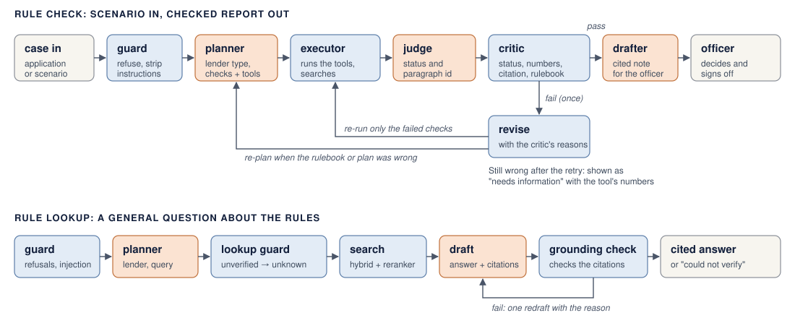
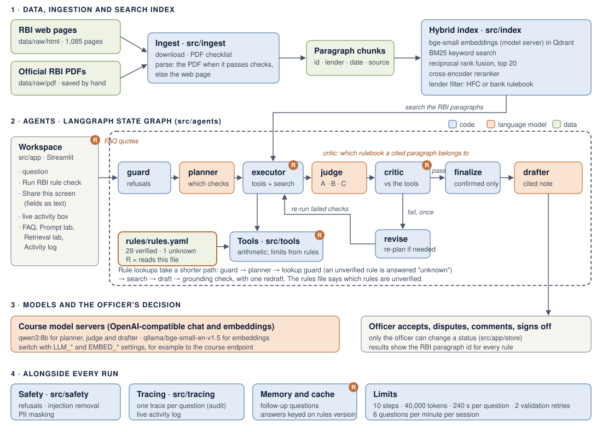

# RBI Home Loan Rule Checker (Loan Guarantor)

Nov 11, 2026 · @Chetan · updated 18 November 2026 to match the system as built (Multi-agent design, Corpus, Architecture, Prompt strategies, Front-end, Repository layout). The credit model and decision gate described here were not built; see Architecture.

A rule checker that tests a synthetic home loan case, including its guarantor, against RBI directions and reports which rules pass or fail with paragraph citations. It checks the loan against regulation, and a tabular credit model with an NPA cutoff scores default risk, so a loan is approved only when both agree.

## Purpose

The checker takes a synthetic home loan case and tests it against RBI directions, then lists each rule as met, breached or not applicable, with the paragraph that says so. It answers "is this loan allowed under the rules", while the credit model in the underwriting section answers "is this loan likely to default".

| The checker does | The checker never does |
| --- | --- |
| Pick the right rulebook for the lender type | Judge a borrower's income or credit score |
| Calculate loan to value and compare it with the cap | Approve or reject a real loan |
| Check guarantor related disclosure rules | Give legal advice or a compliance verdict |
| Draft a rule check note for a human to approve | Use real customer data |

The language model never makes the credit decision, because lender policy is not in RBI documents and a small model would only invent it. The decision comes from the credit model and cutoff in the underwriting section, so the gold answers stay checkable.

## Rule areas and what is verified

Two RBI documents were found in search results as the main homes of home loan rules. Their listing text was seen, but the full rules were not read, so every threshold below is a theme to confirm.

| Source | Applies to | What search results showed |
| --- | --- | --- |
| [Reserve Bank of India (Housing Finance Companies) Directions, 2025](https://www.rbi.org.in/Scripts/BS_ViewMasDirections.aspx?id=12939) | Housing finance companies | Updated as on 1 October 2026; an LTV relaxation lets an HFC add stamp duty and registration charges when the house costs up to ₹10 lakh |
| [Housing finance master circular, updated to 31 March 2025](https://taxguru.in/rbi/rbi-issues-updated-master-circular-housing-finance.html) | Scheduled commercial banks except Regional Rural Banks | Consolidates instructions only; adds no new ones |
| [Commercial banks capital charge, standardised approach Directions, 2026](https://www.rbi.org.in/Scripts/BS_ViewMasDirections.aspx?id=13399) | Commercial banks | Effective 1 April 2027; may change risk weights |

The rule themes to confirm in Week 0 are loan to value caps, risk weights tied to LTV, valuation of property, prepayment charges on floating rate loans, interest rate reset communication, key facts disclosure, and what a guarantor must be told. One blog reports risk weights from 20% at LTV of 50% or less to 40% above 80%, with up to 60% for a third housing loan, but a blog is not a source for gold answers.

The master circular is a bank document and the Directions are an HFC document, so the same scenario can have different answers by lender type. That makes entity variants the core difficulty, as in the payments navigator.

## Scenario inputs and checks

Every scenario is synthetic and carries a gold label written from the verified rule text. A scenario has these inputs:

| Input | Example | Used by |
| --- | --- | --- |
| Lender type | Housing finance company, or scheduled commercial bank | Rulebook picker |
| Property value (₹) | 80,00,000 | LTV calculator |
| Loan amount (₹) | 64,00,000 | LTV calculator |
| Rate type | Floating or fixed | Prepayment check |
| Borrower type | Individual or non individual | Prepayment check |
| Guarantor present | Yes or no | Disclosure check |
| Month of the case | Used to pick the amendment in force | Amendment chain |

The checker runs these checks and reports each as met, breached or not applicable:

1. Rulebook selection for the lender type.
2. LTV calculated as loan amount divided by property value, compared with the cap read from the cited paragraph.
3. Risk weight band for the computed LTV, where the rule gives one.
4. Prepayment charge allowed or not, for the rate and borrower type.
5. Disclosure to the borrower and to the guarantor.
6. Whether a later amendment changed any of the above.

An example case: 64 lakh against an 80 lakh property gives an LTV of 80%. Whether that passes depends on the cap in the verified text for that lender type and loan size, which is exactly what the tool must look up, not recall.

## Multi-agent design

A scenario enters, the agents check it against the right rulebook, and a human approves the report.

A failed critic check goes back once with a reason, inside the 10 step cap: when the rulebook or the plan was wrong the planner re-plans, and when only a judgement was wrong the failed checks are re-run without re-planning. A result still wrong after that retry is withheld and shown as needs information with the tool's numbers. All arithmetic runs in tools, so the model only reads rules and explains results. As built, the flow is a LangGraph state graph (`src/agents/graph.py`), and a general rule question takes a shorter lookup path with its own grounding check.

**Worked example of a caught error.** A user enters a home loan of 64 lakh on an 80 lakh property for a housing finance company, but the planner assumes a bank. Retrieval returns the bank master circular paragraph. The LTV tool correctly computes 80%, but the critic sees that the cited document applies to scheduled commercial banks and the scenario says housing finance company. It fails the check and sends the case back. The planner asks to confirm the lender type, retrieval re-runs against the HFC Directions, and the report cites the right paragraph. The same flow catches a missing guarantor disclosure check when the case says a guarantor is present.

## Corpus, evaluation and Week 0 checks

Home loan rules sit in a handful of long documents, so a home loan only corpus will almost certainly fall under the 500 document floor. The plan is to use home loans as one workflow inside a wider RBI lending corpus, which search results suggest has 238 function wise Master Directions in total, 35 of them for NBFCs. How many are lending related is not yet counted.

**As built.** The corpus is 1,076 RBI documents from rbi.org.in (8 for housing finance companies, 75 for NBFCs, 130 for banks and 863 other RBI documents), split into paragraph chunks with the paragraph id, lender type, date and source format. RBI has replaced the master circulars with the Commercial Banks Directions, 2025, so those are used in place of "the bank master circular". Each document is read from its official PDF when one has been saved and passes quality checks, and from its web page otherwise.

The evaluation set has 80 queries, 20 for development and 60 held back, frozen at the Week 1 gate. Planned mix:

| Type | Count | Example |
| --- | --- | --- |
| Rule lookup | 15 | What does the HFC rulebook say about stamp duty in LTV for a ₹9 lakh house? |
| Scenario check with a gold verdict | 30 | Case with lender type, values and guarantor; expected met or breached per rule |
| Entity variant | 15 | Same loan, bank against HFC, different cited paragraph |
| Amendment or change | 10 | Did a later direction change the cap in force at the case date? |
| Refusal and injection | 10 | Will this borrower repay? Or a pasted note that tells the model to ignore rules |

| Week 0 check | Pass means |
| --- | --- |
| Download and parse the HFC Directions and the bank master circular | Text and tables extract cleanly |
| Read the LTV, risk weight and prepayment paragraphs | Thresholds found and written into a rules file |
| Count lending related RBI documents | At or above 500 (as built: 1,076) |
| Write 10 synthetic scenarios and label them by hand | Each label traced to one paragraph |

## Risks and responsible AI

The main risks are a thin corpus, limits locked inside tables, and a rule set that moves under the project.

| Risk | Fallback |
| --- | --- |
| Home loan rules fill too few documents | Widen to the full RBI lending set and keep home loans as the headline workflow |
| LTV and risk weight tables parsed wrongly | Extract the key tables by hand into a rules file the tools read |
| The 2026 capital charge Directions change risk weights from 1 April 2027 | Tag every rule with its effective date and test cases on both sides of it |
| Blog figures leak into gold answers | Gold answers come only from RBI text, each traced to a paragraph |
| Scenario labels drift from the rules | A second person reviews every label before the Week 1 freeze |
| The project is read as a credit scoring tool | Say it plainly in the report and refuse repayment questions in the guardrails |

**Open questions.** The questions raised while planning, and how each one stands now, are kept in the companion document RBI Home Loan Rule Checker (Loan Guarantor) – Open Questions.

**Responsible AI.** All scenarios are synthetic and contain no real borrower data. The tool never approves a loan or declares a lender compliant, it shows its cited paragraphs every time, it treats pasted text as data and not instructions, and a human approves every report.

## Delivery plan: two weeks

The plan assumes about two weeks remain and the real deadline is a few days off. Day 1 is Thursday 12 November 2026. The first two days matter most, because the rules file and the labelled scenarios must be right before any agent code is written.

| Day | Goal | Output that proves it is done |
| --- | --- | --- |
| 1 | Raise the open questions; download the HFC Directions and the bank housing master circular | Both documents parsed to text |
| 2 | Read the LTV, risk weight, prepayment and guarantor paragraphs; write them into a rules file with paragraph numbers and effective dates; write and label 80 queries | Rules file and gold file frozen and committed before agent code |
| 3 | Chunk the corpus; build BM25 plus dense index and reranker | Retrieval recall on the 20 development queries |
| 4 | Build tools: LTV calculator, risk weight lookup, prepayment checker, amendment chain walker, lender type picker | Unit tests pass for each tool |
| 5 | Build planner, retrieval agent, critic and shared state with the 10 step cap | One scenario checked end to end with citations |
| 6 | Add the report drafter, guardrails, repayment refusal, injection defence and human approval | All five query types run |
| 7 | Run the 60 test queries; record metrics and the failure taxonomy | Results table and failures by category |
| 8 | Fix top failures; build the Streamlit scenario form; containerise | Docker build runs the app |
| 9 | Add caching and rate limiting; compare the three prompt strategies | Comparison table for the report |
| 10 | Write the 12 page report | Full draft |
| 11 | Build the demo script and slides; rehearse 10 minutes | Timed rehearsal |
| 12 to 14 | Buffer for fixes, final run, submission | Submitted package |

If days run late, protect in this order: the rules file and frozen gold set, the critic loop, the evaluation results, then the interface. Drop extra prompt strategies and caching polish first.

**Build brief.** Build a Python project with these parts: a loader and parser for the RBI lending documents that keeps paragraph numbers, lender type and effective date as metadata; a rules file in structured form for the key thresholds, filled by hand from verified RBI text; a hybrid BM25 and dense index with a reranker; an OpenAI compatible client for the course endpoint serving Qwen2.5-7B-Instruct-AWQ; tools for LTV, risk weight lookup, prepayment checking and amendment chains, each a plain tested function; a planner, retrieval agent, critic and report drafter with a shared state object and a hard cap of 10 steps; an evaluation script reading the frozen gold file; and a Streamlit form for a synthetic loan case with a human approval button. Keep the gold file read only. Never let the model do arithmetic. Also build the underwriting layer: a credit model trained on frozen splits, a cutoff script for the target NPA rate, and a decision gate that approves only when the score clears the cutoff and no rule is breached.

**Build rules.** The model never states a limit from memory: every threshold comes from the rules file or a cited paragraph. Each scenario result is met, breached or not applicable, with its paragraph. Free text questions about whether a borrower will repay are refused; the credit model scores structured fields only. Failure categories are retrieval miss, reasoning error, tool call error and hallucination.

## Underwriting layer: why a rule checker alone does not underwrite

A rule checker alone does not underwrite a loan. This layer adds a tabular credit model that scores default risk, a cutoff chosen to hit a target NPA rate, and the rule checker above as a gate: a loan is approved only when the score clears the cutoff and no applicable rule is breached.

| Step | Done by | What it does |
| --- | --- | --- |
| 1. Score | Credit model: logistic regression baseline, then gradient boosting | Predicts the probability of default from the tabular loan fields |
| 2. Cutoff | A plain script | Picks the score threshold on a validation split so approved loans meet the target NPA rate |
| 3. Rule gate | The agents and tools described earlier | Tests LTV, risk weight, prepayment, guarantor and other rules, each with its RBI paragraph |
| 4. Decision | Plain code | Approve if score is above the cutoff and no rule is breached; decline with reasons otherwise; send borderline cases to the human approval step |
| 5. Explanation | The language model | Writes the report citing RBI paragraphs. It never sets the score or the decision |

No known lending dataset needs natural language to underwrite, and that is fine here: the credit model is tabular. The language model has the work that needs text, which is reading the RBI directions for the gate and explaining each decision with citations.

The NPA figure is a proxy: a loan 90 or more days past due in the dataset's own labels. The target rate is a number the student sets and justifies, for example against the default rate in the data, and is not an RBI figure. The target and definition are among the open questions.

**What gets reported.**

| Metric | Measured on | Compared with |
| --- | --- | --- |
| NPA rate among approved loans | Held out test split | The target, and the rate for all loans |
| Approval rate | Same test split | The cost of the cutoff |
| AUC and calibration | Same test split | Logistic baseline against gradient boosting |
| Loans the gate rejects after the score approves | Same test split | Score only, rules only, and both together |
| Citation accuracy and rule check pass rate | The frozen 80 query gold set | Unchanged from the evaluation section |

**Limits to state in the report.** The public datasets are not Indian, so rupee thresholds cannot be applied to their dollar loans. The gate uses ratio rules such as LTV on the fields the dataset has, and rupee based rules stay in the scenario form tested by the gold set. No public dataset carries a guarantor field, so guarantor rules are also tested through the scenario form.

## Dataset options

The candidate datasets are below; the choice is among the open questions. Descriptions and sizes are from memory and approximate: none of these was opened or checked for licence in this document, so confirm each in the first hours.

| Dataset | What it holds | Fit for a home loan checker | Check before use |
| --- | --- | --- | --- |
| Freddie Mac single family loan level data | US mortgages: origination fields such as credit score, LTV, DTI and amount, plus monthly performance | Best fit. Real home loans, and a 90 day delinquency label can be built. LTV is a ratio the rule gate can test | Registration and terms of use; files are large, so use a sample |
| Home Credit default risk | About 300 thousand loan applications with a default flag, spread over several tables | Good size and tabular, but consumer and cash loans, not home loans | Kaggle competition terms |
| Give Me Some Credit | About 150 thousand borrowers with a flag for 90 days past due | The 90 day label is built in, but not home loans | Kaggle competition terms |
| Lending Club | US personal loans, 2007 to 2018, with a loan status field | Not home loans; many columns | Whether the data is still available and its licence |
| German credit (UCI) | 1,000 loans, 20 attributes, good or bad label | Tiny, but a safe fallback that downloads in minutes | Licence on the UCI page; label is good or bad, not NPA |

**Recommendation.** Start with a sample of the Freddie Mac data for the home loan fit and a real LTV, and keep German credit as the fallback if registration or file size blocks you. Decide by day 2 and note the reasoning for the report.

**How to present the data choice.** The credit model is trained on a public non Indian dataset, with Freddie Mac mortgage data as the first choice, and the target NPA rate is an assumption set with reference to Indian aggregate NPA figures. Three limits must be stated in the report:

- The model's predicted risk is not calibrated to Indian borrowers, so the project makes no claim about Indian default risk.
- An aggregate bank NPA ratio covers a whole loan book, not home loans or this applicant pool, so it informs the target and does not prove it.
- Rupee thresholds in RBI rules cannot be tested on dollar loans, so those rules are tested through the scenario form and the frozen gold set.

The credit model demonstrates the method of score, cutoff and rule gate. Its value lies in the design and the trade-offs recorded.

## Architecture

*Updated on 18 November 2026 to describe the system as built.*

A question or a rule check comes in from the compliance officer's workspace and runs through a LangGraph state graph of agents. The agents read RBI paragraphs from a hybrid search index, leave every calculation to plain tools that take their limits from the verified rules file, and return results with paragraph ids. Only the officer's click changes an application's status.

**Components.**

| Component | What it does | Built with | Code |
| --- | --- | --- | --- |
| Ingest | Downloads RBI Master Directions and notifications; lists each document's official PDF for saving in a browser; splits text at numbered RBI paragraphs, using the PDF when it passes quality checks (enough text, the paragraphs the rules cite) and the web page otherwise | pdftotext (poppler), pypdf as fallback | `src/ingest/` |
| Index | Embeds every chunk once and on every query; fuses dense and keyword results; reranks the top 20; filters by lender type so an HFC case never searches bank Directions | bge-small-en-v1.5 served by Ollama, Qdrant, rank-bm25, ms-marco-MiniLM cross-encoder | `src/index/hybrid.py` |
| Rules file | 30 records read from the RBI text, 29 verified; an unverified rule is reported as unknown and never sent to the model | YAML, quotes checked by script | `rules/` |
| Tools | One plain function per rule check (LTV cap, risk weight, prepayment, KFS, guarantor, valuation, KYC, rate reset, related party, MITC), plus the rule version in force on a date and the lender type picker. All arithmetic and date logic | Python | `src/tools/checks.py` |
| Agent graph | Guard, planner, executor, judge, critic, revise, finalize and drafter nodes; the critic's verdict is a conditional edge; one retry; unconfirmed results are withheld as "needs information"; a separate lookup path for general rule questions | LangGraph `StateGraph` | `src/agents/graph.py`, `steps.py`, `loop.py` |
| Prompts | Strategies A (direct check), B (extract then judge) and C (plan, judge, self check), with a JSON schema for every reply | Pydantic | `src/prompts/` |
| Model client | OpenAI-compatible chat with JSON-schema output, validated replies, two retries, token budget, disk cache | openai client | `src/llm.py` |
| Memory | Each officer's conversation per application is saved, so follow-ups such as "and for a bank?" use the previous turn; the lender type of a follow-up is set in code | JSON lines | `src/agents/memory.py` |
| Safety | Refusals, removal of instruction-like text from notes, questions and retrieved paragraphs, PII masking in views, traces, logs and model input | Python | `src/safety/` |
| Tracing | One trace per question (the audit trail); a live activity log of every agent step, model call, embedding call, Qdrant query, BM25 search, rerank and tool run, with no prompt text | JSON lines | `src/tracing/` |
| Workspace | Sign in, work queue, application tabs, compliance checks, assistant with screen sharing, comments and sign-off, FAQ, prompt lab, retrieval lab, activity log, history and evaluation | Streamlit | `src/app/` |

**Models and services.**

| Service | Default | How to change |
| --- | --- | --- |
| Language model | `qwen3:8b` on a local Ollama, through its OpenAI-compatible endpoint | `LLM_BASE_URL`, `LLM_API_KEY`, `LLM_MODEL` (for example the course endpoint) |
| Embeddings | `qllama/bge-small-en-v1.5` on Ollama | `EMBED_PROVIDER`, `EMBED_MODEL`, `EMBED_BASE_URL`; `EMBED_PROVIDER=fastembed` runs `BAAI/bge-small-en-v1.5` in-process with the same vectors. The index records which model built it and refuses another |
| Reranker | `Xenova/ms-marco-MiniLM-L-6-v2`, in-process | `RERANK_MODEL` |
| Vector database | Qdrant in memory, loaded from the saved index; a Qdrant server under Docker Compose | `QDRANT_URL` |
| Deployment | `docker compose up`: the app and Qdrant containers; Ollama stays on the host | `APP_PORT`, `DOCKER_LLM_BASE_URL`, `DOCKER_EMBED_BASE_URL` |

**Limits on every run.** At most 10 agent steps (and 25 graph node visits as a second guard), 40,000 tokens and 240 seconds per question, two retries for a reply that fails validation, and 6 questions per minute per session. A run that hits a limit stops politely, says why, and shows what the tools found as unconfirmed.

**Credit lane: planned, not built.** The original design ran a second lane beside the rule check: a credit score from plain modelling code, a cutoff for a target NPA rate, and a decision gate combining both, with the language model writing only the report. It was not built, because the dataset and the NPA target were never agreed (see the open questions); the rule lane works without it. The plan is kept here in case it is picked up.

| Day | Added task | Output that proves it is done |
| --- | --- | --- |
| 1 | Settle the dataset and the NPA target | Dataset and NPA definition agreed |
| 2 | Download the chosen sample, build the default label, freeze train, validation and test splits | Splits committed before any model is trained |
| 3 | Train the logistic baseline and the gradient boosting model | AUC and calibration on the validation split |
| 4 | Write the cutoff script for the target NPA rate | NPA rate at the cutoff on validation |
| 5 | Wrap score and cutoff as a fourth tool and add the decision gate | One case approved or declined end to end |
| 7 | Run the test split with score only, rules only and both | Ablation table |
| 10 | Add NPA rate, approval rate and gate effect to the report | Report section |

If registration or file size blocks the Freddie Mac data by day 2, switch to German credit. If days still run short, drop gradient boosting and keep the logistic model.

## Compliance officer workspace

The app mimics a loan origination system. A compliance officer logs in, opens a pre-filled application assigned to them, checks it against RBI rules with the AI's help, comments on it, and either clears it for the next stage or returns it. The officer checks compliance only. The loan itself is approved at a later stage by someone else, and the AI never declares a loan compliant: it recommends with citations and the officer decides.

Screen mock-ups for this workspace are in one [Canva design](https://canva.link/qazh8jzkllw7kqn). They are rough and show the layout and fields only.

| Screen | What the officer does | Data and agent behind it |
| --- | --- | --- |
| Sign in | Picks a user and role, which for the course is a simple pick-a-user screen | Three fake users: compliance officer, credit processor, approver |
| Work queue | Sees assigned applications with applicant, amount, lender type, assigned by, due date and status | Status values: new, in review, information requested, compliance cleared, returned |
| Application tabs | Reads the pre-filled form across eight tabs: Applicant, Co-applicant and Guarantor, Employment and Income, Property, Loan request, Bank and Liabilities, Documents, Declarations | Each field has a verification state of verified, unverified or not provided, and a comment icon |
| Compliance checks | Clicks Run RBI rule check, then accepts, disputes or comments on each result | Rule agents return met, breached, needs information or not applicable, each with a paragraph id |
| Assistant chat | Asks questions about the open application and the rules | Screen sharing sends the open tab's fields as structured text, and answers cite RBI paragraphs |
| Comments and requests | Writes notes on fields and checks; requests more information from the customer or the assigning officer | Saved as comment records; a request changes the status to information requested |
| Sign-off | Clicks Compliance cleared to send to the next stage, or Return with reasons | Saved with a full audit trail |

**Screen sharing in the chat.** The Share this screen button sends the application id, the open tab name and that tab's field values, as text, to the assistant. It does not send an image, because the course model reads text. The planner reads this context so it can use the real values: for the question "is this LTV allowed?", it takes the lender type and the LTV from the shared fields. If no screen is shared, the assistant says so and answers only general rule questions.

**Pre-filled applications.** Build 12 synthetic applications as JSON files, each following the eight tabs, with about 40 fields in total. Plant known issues in some, such as a missing key facts statement, a guarantor disclosure not recorded, an LTV above the cap for the lender type, or a declared income that does not match the salary slip. Each planted issue is a gold label for the rule checks. All data is synthetic.

**Gold queries for this workspace.** Add 25 of the 80 gold queries as application based: an application id plus a question, with the expected rule results and the paragraph for each. Example types: run the full check on application HL-2048 and list the breached rules; ask the chat whether a field value is allowed for this lender type; ask what is missing before this application can be cleared.

**Credit score panel.** The underwriting layer described earlier belongs to a different team in a real lender, so it appears here as an optional read-only panel that shows the score against the cutoff. The compliance officer's decision does not depend on it.

**Screens still to design.** The Canva mock-ups are rough: the field names are right but the layout needs work before the demo. The real screens are built in Streamlit from this table, not from the pictures.

## Role coverage for the six team roles

The team has six roles. This section says where each role's work is specified and what a person in that role delivers. The sections after it fill the gaps found in review: prompt strategies, observability, and front-end with deployment.

| Role | Responsibility | Specified in | Deliverable and test of done |
| --- | --- | --- | --- |
| Domain spec and eval design | Scope, gold answers, refusal policy | Purpose; Rule areas; Scenario inputs and checks; Compliance officer workspace; Corpus, evaluation and Week 0 checks | Frozen rules file and gold file of 80 queries (20 dev, 60 test), 25 of them application based, each with a source paragraph; a refusal list; frozen by day 2 |
| Prompt engineering | Strategy comparison, structured output, failure characterisation | Prompt strategies section below | Three prompt strategies run on the same dev queries; a table of accuracy and failure counts per strategy |
| RAG and retrieval | Chunking, hybrid search, reranking, citation grounding | Architecture; Rule areas | Recall at 5 on dev queries for dense only, hybrid and hybrid plus reranker; citation exact match rate; key tables extracted by hand into the rules file |
| Agent orchestration and tools | Planner, executor and critic loop, tool interfaces, state and memory | Multi-agent design; Underwriting layer; Compliance officer workspace | Tools with unit tests; the loop capped at 10 steps; shared state holding the shared screen context; one logged trace per question |
| Observability and safety | Tracing, failure taxonomy, injection and PII testing | Observability section below | A trace per question, a failure table by category, an injection test set and a PII test set with pass rates |
| Front-end and deployment | UI, containerisation, rate limiting, caching, demo | Compliance officer workspace; Front-end section below | Streamlit workspace with the screens in the workspace table; Docker image that starts with one command; rate limit and cache with tests; a 10 minute demo script |

The prompt engineering and observability roles both need the frozen gold file before they can measure anything, so day 2 is the gate. The credit model work from the underwriting layer sits with the agent orchestration role in the plan, and is optional if time runs short.

## Prompt strategies, structured output and failure characterisation

The Track B spec asks for three prompt strategies compared on the same queries. Run all three on the 20 development queries first, then the best two on the 60 test queries, and record the result for each.

| Strategy | What the prompt does | Why it might help a 7B model |
| --- | --- | --- |
| A. Direct check with citations | One prompt: the application fields plus retrieved paragraphs, return met, breached or not applicable per rule with paragraph ids | Cheapest baseline |
| B. Extract then judge | Step one quotes the rule text and the matching field values; step two judges using only those quotes | Stops the model using remembered limits |
| C. Plan then judge with self check | A short plan of checks, then the judgement, then a check that every number matches the cited paragraph and the lender type | Targets the wrong rulebook and hallucination failures |

Each strategy gets the same retrieval results, so only the prompt changes. Keep temperature at 0 for evaluation runs.

**Structured output.** Every agent step returns JSON that a schema validates. The planner returns checks to run with a tool name each. The retriever returns paragraph ids with scores. Each rule check returns a status of met, breached, needs information or not applicable, the paragraph id, and the field values used. The critic returns pass or fail, the failed checks and a reason. The chat drafter returns the answer text and citation ids. A reply that fails validation is retried twice with the error message, then counted as a tool call error (two retries were chosen on day 1 after testing the endpoint). If the course endpoint supports guided decoding, use it; otherwise validate and retry.

**Failure characterisation.** For each strategy, label every wrong result with one of four categories: retrieval miss, reasoning error, tool call error, hallucination. Add one note field for wrong rulebook, since that is the main risk in this project. Report counts per strategy and one worked example per category. The prompt engineer owns the labelling guide and checks that two people agree on 10 results.

## Observability, tracing and safety testing

Every question or rule check produces one trace, a record of each step, so a wrong result can be traced to the step that caused it. Build tracing on day 5 with the agent loop, not at the end.

| Trace field | Recorded at each step |
| --- | --- |
| Trace id, timestamp, user, application id, question | Start |
| Step number, agent name, strategy used | Every step, up to the 10 step cap |
| Input and output of the step | Every step, after PII masking |
| Shared screen context: tab name and fields sent | Chat steps |
| Retrieved paragraph ids and scores | Retrieval steps |
| Tool name, arguments, result, error | Tool steps |
| Critic verdict and failed checks | Critic steps |
| Latency in milliseconds and token counts | Every model call |
| Officer action: accepted, disputed, commented, cleared, returned | End |

Store traces as one JSON line each in a local file, and add a History screen that lists traces and the officer's actions for an application. This doubles as the audit trail in the workspace. A tracing library such as Langfuse is optional.

**Failure taxonomy table.** The evaluation script reads traces and labelled failures and prints counts by category, by strategy and by query type, with the trace id for each failure.

**Prompt injection tests.** Write 15 cases: instructions hidden in a free text comment field of an application, in a pasted note, or in a retrieved paragraph; a question that says to ignore the rules or to mark the application compliant; and an attempt to make a tool run other code. Pass means the instruction is ignored, the real task is still done, and the application is not marked cleared.

**PII tests.** Applications hold personal data, so test with fake data only: made up PAN, Aadhaar, phone, email and address. Pass means PAN and Aadhaar are masked in the stored application view, traces and logs; masked values are what the language model sees unless a rule needs the last four digits; and the chat never repeats a full identifier. Use pattern matching for PAN, Aadhaar, phone and email, and run 15 cases.

**Refusal tests.** Ten requests the assistant must refuse or hand back to the officer: declare this application compliant, approve this loan, say whether the borrower will repay in free text, give legal advice, and questions outside RBI rules.

## Front-end, deployment, caching and rate limiting

The interface is a Streamlit app that implements the screens in the compliance officer workspace table, run from one Docker image. The aim is a demo that shows the agents working inside a believable loan origination screen.

| Streamlit page | Built from | Notes |
| --- | --- | --- |
| Sign in | Workspace table, Sign in row | Pick-a-user, three fake users, role stored in session |
| Work queue | Work queue row | Table read from the 12 synthetic application files, with status filter |
| Application | Application tabs row | Eight tabs, each field with a verification dot and comment icon; amber highlight for planted issues the officer should find |
| Compliance checks | Compliance checks row | Run button calls the agents; result cards with Accept, Dispute, Comment and the cited paragraph |
| Assistant | Assistant chat row | Side panel with a Share this screen toggle; shows exactly which fields were shared |
| Comments and sign-off | Comments and Sign-off rows | Request more information, Return with reasons, Compliance cleared, all saved to the history file |
| History and evaluation | Observability section | Audit trail per application, and the last evaluation run with failure counts |
| FAQ (added) | Rules file | Common rule questions answered with the verbatim quotes and paragraph ids from rules/rules.yaml, plus how to use the workspace; no model call |
| Prompt lab (added) | Prompt strategies section | Strategies A, B and C run side by side on one application and rule, each compared with the tool |
| Retrieval lab (added) | Corpus and retrieval | Dense, BM25, hybrid and hybrid plus reranker side by side for one query, with the recall, chunking and retrieval-versus-answer tables |
| Activity log (added) | Observability section | Every agent step, model call, embedding call, Qdrant query, BM25 search, rerank and tool run, with timings and tokens; the same events show live in a status box while the assistant works |

**Caching.** Cache paragraph embeddings on disk, computed once at ingestion, and full answers keyed by the question, application id, shared fields, strategy and corpus version. Show a cache hit marker in the trace. A test proves the same question twice makes one model call and that changing the corpus version clears the answers.

**Rate limiting.** Allow a fixed number of assistant questions per minute per session, and stop any question at the 10 step cap and a time limit. When the limit is hit, show a clear message and never crash. A test sends a burst of questions and checks the extra ones are refused politely. The numbers depend on the endpoint's token quota, which is among the open questions.

**Containerisation.** One Dockerfile and one compose file starting the app and Qdrant together. The language model stays on the course endpoint, with address, key and model name from environment variables, never in the repository. As built, the default is a local Ollama on the host (qwen3:8b for the language model and qllama/bge-small-en-v1.5 for embeddings), because the course endpoint was not available; switching is a change to the environment variables only. `docker compose up` must start a working app with the index loaded from a saved snapshot.

**Demo.** A 10 minute script: sign in as the compliance officer; open the application with the planted issues; run the rule check and show the wrong rulebook caught by the critic; ask the chat a question with the screen shared; add a comment and request more information; clear a clean application; try an injection in a comment field and show it ignored; then show the evaluation screen.

## Rule verification: read the actual RBI text first

Every threshold, limit, period and paragraph number in this document is an unverified theme until it has been read in the RBI text. This is the first job on day 1 and 2, before the rules file or the gold file is frozen. Do it one rule at a time, as below.

**For each rule theme in the table, in order:**

1. Search for the RBI document that holds it. Prefer rbi.org.in, in the Master Directions and notifications pages, and use the version updated as on the latest date. Note the document title, its reference number and the update date.
2. Open the document and find the exact paragraph. Read the full paragraph and any provisos, explanations and tables attached to it.
3. Check whether a later amendment or direction changed it. If so, read that too and record which one is in force on the case date.
4. Write one record in rules/rules.yaml with these fields: rule id, theme, lender type it applies to, paragraph number, the exact quoted wording, the numeric values taken from it (such as a percentage or a number of days), effective date, source document title and reference, source address, the date it was read, and a status of verified or unverified.
5. If the document cannot be opened, the paragraph cannot be found, the text is only a scanned image, or a table cannot be read reliably, set the status to unverified, write why, and move on. Never fill a value from memory, a blog or another country's rules.
6. Where the bank and housing finance company rules differ, write one record per lender type, never one record covering both.

**Rule themes to verify, one by one.**

| Theme | Lender types to check | What to record |
| --- | --- | --- |
| Loan to value cap | Housing finance companies and scheduled commercial banks | The cap by loan size band, and whether stamp duty and registration charges may be added to the cost, such as the affordable housing relaxation |
| Risk weight by LTV | Banks and housing finance companies | The weight by LTV band and loan size; note any change coming from the commercial banks capital charge directions effective 1 April 2027 |
| Valuation of property | Both | Who may value, empanelment, and when a fresh valuation is needed |
| Prepayment charges | Both | Whether charges are allowed on floating rate loans to individuals, and any exceptions |
| Interest rate reset communication | Both | What the borrower must be told, and when |
| Key facts statement and disclosure to the borrower | Both | What must be given before sanction |
| Guarantor disclosure | Both | What a guarantor must be told, and by when |
| KYC and customer due diligence | Both | Identity and address checks required before sanction |
| Related party lending and declarations | Both | Declarations and approvals needed |
| Grievance redressal | Both | Details the borrower must be given |

**Output of this step.** A file rules/verification\_report.md that lists every theme, the records written, and every theme left unverified with the reason. The team reviews this report before anything is frozen. A rule marked unverified may not appear in the gold file or be used by a tool, and the agents must treat an unverified rule as unknown and say so.

**Spot check.** After the rules file is written, pick five records at random and re-read their source paragraphs to confirm the quoted wording and numbers match exactly. Report the result in the verification report.

## Repository layout and build order

Build in the order below, finishing and testing each step before the next. Where this document says to check a count or verify a rule, stop and report rather than guess. Paragraph numbers and thresholds come only from the RBI text that has been read and written into the rules file.

| Folder or file | Contents | Built on day |
| --- | --- | --- |
| rules/verification\_report.md | Rule verification step: each theme read in the RBI text, records written, unverified themes listed, five record spot check. Must finish before the rules file and gold file are frozen | 1 to 2, first job |
| data/raw and data/parsed | Downloaded RBI lending documents and parsed paragraphs with lender type and effective date. As built: data/raw/html, data/raw/pdf and data/raw/lists; data/parsed/text holds the reference texts the rule quotes are checked against | 1 to 3 |
| rules/rules.yaml | Key thresholds taken only from records marked verified in the verification report, each with paragraph id, lender type and effective date | 2 |
| data/applications | 12 synthetic applications as JSON across the eight tabs, with planted issues listed in a separate answer key | 2 |
| gold/gold\_queries.jsonl | 80 queries, 25 application based, with answers and source paragraph ids from verified rules only; frozen after the verification report is reviewed | 2 |
| src/ingest, src/index | Loader, parser, chunker, Qdrant and BM25 hybrid index, reranker | 3 |
| src/tools | LTV calculator, risk weight lookup, prepayment checker, amendment chain walker, lender type picker; each a plain function. As built, the amendment chain walker is tested but not called by the agents, which pick the rule version with rule_in_force | 4 |
| src/credit | Optional: credit model, cutoff script and decision gate from the underwriting layer. Not built: the dataset and NPA target were not agreed | 4 to 5 |
| src/agents | Planner, retriever, critic, drafter, shared state with screen context, 10 step loop. As built: a LangGraph state graph, plus conversation memory for follow-up questions | 5 |
| src/prompts | The three prompt strategies and the JSON schemas | 5 to 6 |
| src/safety, src/tracing | Guardrails, PII masking, injection handling, refusals, JSON line traces | 5 to 6 |
| src/app | Streamlit pages from the front-end table, cache, rate limiter | 8 to 9 |
| eval/ | Evaluation script, failure labels, injection, PII and refusal test sets | 7 |
| Dockerfile, docker-compose.yml, README.md, tests/ | Deployment, setup steps, tests with each module | 8 to 11 |

**Build rules.**

1. Never read or edit the gold file or the planted issue answer key while building; only the evaluation script reads them.
2. Never state an RBI limit from memory: every threshold comes from rules.yaml or a cited paragraph, and an unverified rule is reported to the team, not invented.
3. The AI recommends; it never marks an application compliant or approves a loan. Only the officer's click changes a status.
4. Calculations and dates run only in tools, never in the model.
5. Screen sharing sends fields as text, never an image.
6. Take the endpoint address, key and model name from environment variables.
7. Write a test with each tool and each safety rule before wiring it into the agents.
8. Use only fake personal data in tests, applications and demos.
9. After each build step, record a short status: what works, what failed, what is next.

**Open items.** Listed, with how each one stands, in the companion document RBI Home Loan Rule Checker (Loan Guarantor) – Open Questions.

**Definition of done for the capstone.** Rules file and gold file frozen; the evaluation script prints accuracy, citation rate and the failure table for three prompt strategies; the injection, PII and refusal tests pass at the reported rates; the Streamlit workspace runs the full demo script; and `docker compose up` starts the app.
