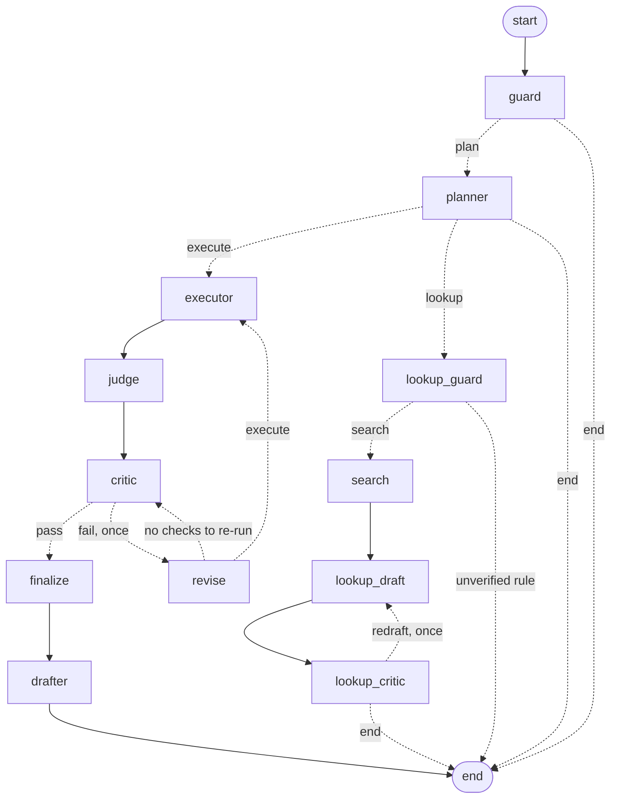

# Agentic layer (Week 3)

How the project meets the Week 3 requirement: *a multi-agent or tool-using system (LangGraph, CrewAI, AutoGen, or hand-rolled) with at least three tools, an explicit planner → executor → critic loop, persistent state across turns, and error handling for tool failures, malformed JSON, infinite loops and token budget caps.*

The flow runs on **LangGraph** (`langgraph` 1.2): a `StateGraph` in `src/agents/graph.py` with one node per agent step and conditional edges for the critic's verdict. The agents, tools, prompts and safety rules are plain Python functions that the nodes call, so the safety rules stay in code where they can be read and tested.

The graph replaced a hand-written loop; its nodes call the same step functions in the same order.

## Summary

| Requirement | Where it lives | Evidence |
| --- | --- | --- |
| Multi-agent, tool-using system | `src/agents/graph.py` (LangGraph), `src/agents/steps.py`, `src/agents/loop.py` | Six agent roles: guard, planner, executor, judge, critic, drafter |
| At least three tools | `src/tools/checks.py`, `src/index/hybrid.py` | 10 rule check tools, the hybrid search tool, and the rule-version tool `rule_in_force` |
| Explicit planner → executor → critic loop | `src/agents/graph.py` `build_graph()` | Critic verdict is a conditional edge; `tests/test_graph.py`, `tests/test_agents.py::test_clean_run_passes_critic_and_writes_one_trace` |
| Persistent state across turns | `src/agents/memory.py`, `src/app/store.py` | Conversation saved per officer and application, used for follow-ups; `tests/test_memory.py` |
| Tool failures | `steps.execute_step` (called by the `executor` node), `llm.LLM._raw`, `loop.run` | `tests/test_memory.py::test_a_failing_tool_is_recorded_and_the_run_continues` |
| Malformed JSON | `src/llm.py` `chat_json` | `tests/test_agents.py::test_invalid_json_is_retried_then_counted_as_tool_call_error` |
| Infinite loops | Step cap in `src/tracing/tracer.py`, one retry, LangGraph recursion limit | `tests/test_agents.py::test_step_cap_stops_the_run_without_crashing`, `tests/test_graph.py::test_graph_recursion_limit_stops_a_runaway_loop` |
| Token budget caps | `src/llm.py` `Budget` | `tests/test_agents.py::test_token_budget_stops_politely` |

## The agents

| Agent | What it does | Model or code |
| --- | --- | --- |
| Guard | Refuses approval, compliance declarations, repayment predictions and legal advice; removes instruction-like text; masks PII; loads earlier turns for a follow-up | Code |
| Planner | Decides the intent (rule check, lookup, refuse, out of scope), the lender type and the checks to run | Model, with scope and required checks enforced in code |
| Executor | Runs the tool for each planned check and retrieves the paragraphs for it | Code |
| Judge | Reads the retrieved paragraph and gives a status, the paragraph id and the limit it read | Model (strategy A, B or C) |
| Critic | Compares each judgement with the tool result and the paragraph: status, number, citation, rulebook, missing checks. Reports every problem at once | Code |
| Drafter | Writes the cited note for the officer; falls back to a template if the model fails | Model, with a code fallback |

## The tools

| Tool | What it does |
| --- | --- |
| `check_ltv_cap` | Computes LTV, applies the stamp duty rule, compares with the band for the loan amount |
| `check_risk_weight` | Finds the risk weight band, using the table in force on the sanction date |
| `check_prepayment` | Whether a prepayment charge may be levied |
| `check_kfs` | Key Facts Statement given before the contract |
| `check_guarantor` | Guarantor disclosure; returns "unknown" for banks because the rule is unverified |
| `check_valuation` | Number of valuation reports and independent reports needed |
| `check_kyc` | PAN or Form 60 and identity proof on file |
| `check_rate_reset` | Communication of a floating rate reset |
| `check_related_party` | Loans to directors, their relatives or key managerial personnel |
| `check_mitc` | Most important terms and conditions signed (HFC) |
| `HybridIndex.search` | BM25 plus dense search (bge-small embeddings from the model server, in Qdrant), rank fusion and a reranker over the RBI paragraph index (43,336 chunks) |
| `rule_in_force` | Which version of a rule applies on a date; the rule check tools use it |
| `amendment_chain` | Every version of a rule over time. Built and tested, but not called by the agents |

Only registered tools can run: `run_tool` looks the name up in a fixed table and raises for anything else, so a prompt cannot make other code run. All arithmetic and date logic is in the tools; the model never calculates.

## The graph

`src/agents/graph.py` builds the graph once at import (`GRAPH = build_graph()`); `loop.run()` sets up the run and calls `graph.invoke()`. Solid arrows are fixed edges, dotted arrows are conditional edges chosen by the node's result.

| Node | Role |
| --- | --- |
| `guard` | Refusals, injected instructions, the answer cache and the no-screen case, before any model call. Ends the run when one applies |
| `planner` | The planner agent. Routes to the rule check path, the lookup path, or ends on a refusal |
| `executor` | Runs the tools and retrieval: every planned check the first time, only the failed checks on the retry |
| `judge` | The model's judgement for each check |
| `critic` | Checks the judgements. Pass goes to `finalize`; fail goes to `revise` once; after the retry, anything still wrong is withheld |
| `revise` | The retry: re-plans when the critic found a wrong rulebook or a missing check, with the critic's ruling enforced in code |
| `finalize`, `drafter` | Build the per-rule results and the cited note for the officer |
| `lookup_guard` | Follow-up lender type and unverified rules, decided in code |
| `search`, `lookup_draft`, `lookup_critic` | Rule lookup: retrieve, draft with citations, grounding check, one redraft |

**Graph state.** The graph state is a `TypedDict` with two keys: `ctx`, a `RunContext` holding the case, model client, index, budget, trace and output, and `route`, the edge to take next. Nodes update the context and return a route. No LangGraph checkpointer is used: state across turns is kept by `src/agents/memory.py` (below), and LangSmith tracing is not turned on, so nothing leaves the machine; every node writes to the project's own JSONL trace instead.

**Loop guards.** Two independent limits stop a runaway loop: the trace's 10-step cap (`StepCapReached`), and LangGraph's `recursion_limit` of 25 node visits (`GraphRecursionError`). A full check with one retry visits 11 nodes and uses 8 or 9 steps. Both are reported as a step-cap stop.

## Persistent state across turns

State lives at three levels.

| State | Where | Lifetime |
| --- | --- | --- |
| Within one question | `steps.State`: case, shared screen fields, plan, evidence, tool results, judgements, first-pass judgements, critic feedback, tool errors | One run |
| Across turns of a conversation | `src/agents/memory.py`: one JSON-lines file per officer and application under `STORE_DIR/memory`, holding the masked question, answer, citations, per-rule statuses, lender type and trace id | Survives page reloads and app restarts (a Docker volume in Compose) |
| Across sessions for an application | `src/app/store.py`: status, comments, officer actions and the last rule check; `loop.AnswerCache` for repeated questions | Permanent until cleared |

**How the conversation memory is used.** The loop decides in code whether a question is a follow-up ("and for a bank?", "what about prepayment?", "why is that rule breached?"). Only then does it load the last two turns:

- The planner sees them, wrapped as untrusted data, to work out what the follow-up refers to.
- The search and the unverified-rule guard use the previous question together with the new one.
- The lender type is set in code: the one the new question names, otherwise the previous turn's.
- The answer cache key includes the turns used, so a follow-up is never served an answer meant for a different conversation.

A new question that is not a follow-up does not use history, so its answer does not depend on what was asked before.

Example from a run with a local model:

| Turn | Question | Answer |
| --- | --- | --- |
| 1 | What must a guarantor to a housing finance company home loan be told? | Their liability, the amount, when the HFC will call on them, and the rest, cited to `HFC-MD/158` |
| 2 | And for a bank? | The bank rule is unverified in the rules file, so the answer is unknown; not answered from memory |
| 3 | What about the Key Facts Statement? | Answered for a bank, the lender type carried from turn 2 |

The first version of this feature let the planner choose the lender type for turn 2. The 8B model kept "hfc" from the history and answered the bank question from the HFC paragraph. That is why the follow-up lender type is now decided in code, and a test (`test_follow_up_lender_type_is_decided_in_code`) uses a planner that makes the same mistake.

In the workspace, the assistant panel shows the saved conversation for the open application, says when a follow-up used the previous turn, and has a **Clear conversation** button.

## Error handling

| Failure | What happens | Code |
| --- | --- | --- |
| A tool raises an exception | The error is recorded in the trace (`tool_errors`), that check becomes "needs information" with the error as its note, and the other checks continue | `steps.execute_step` |
| An unverified rule is requested | The tool returns "unknown"; a lookup about it is answered "unknown" in code without asking the model | `checks.run_tool`, `steps.unverified_rule_for` |
| The model endpoint fails | Falls back one feature at a time (JSON schema, then JSON mode, then plain), then stops with "tool call error" and returns the tool results marked unconfirmed | `llm.LLM._raw`, `loop.run` |
| Malformed or invalid JSON | Every reply is validated with Pydantic. On failure the model is asked again with the validation error, twice, then the run stops politely | `llm.LLM.chat_json` |
| A drafting failure | The answer is built from a template of the confirmed results instead | `graph.drafter` |
| Infinite loop or runaway retries | A hard cap of 10 steps per question (`StepCapReached`), LangGraph's recursion limit of 25 node visits (`GraphRecursionError`), and the critic allows only one retry | `tracer.Trace.step`, `graph.RECURSION_LIMIT`, `graph.critic` |
| Token budget | 40,000 tokens per question by default (`QUERY_TOKEN_BUDGET`); the run stops when it is used up | `llm.Budget` |
| Time limit | 240 seconds per question (`QUERY_TIME_LIMIT_S`), plus a 120 second timeout on each model call | `llm.Budget`, `config.LLM_TIMEOUT_S` |
| Too many questions | 6 per minute per session; a refused question gets a wait message, not an error | `src/app/ratelimit.py` |

`loop.run` never raises for any of these: exceptions raised inside a graph node propagate out of `graph.invoke()` and are handled there. A stopped run says why it stopped, returns whatever the tools found marked as unconfirmed, and writes its trace.

**Evidence from the evaluation run.**

- *Malformed JSON:* on dev query Q022 under strategy B, the extract reply was cut off mid-string three times. The run stopped as a tool call error and showed the tool results as unconfirmed.
- *Time limit:* on test query Q026 under strategy C, the local model stalled and the run stopped at the time limit, with unconfirmed rules shown as "needs information".
- *Step cap:* no evaluation run exceeded the step cap; a full check with one retry uses 8 or 9 of the 10 steps.

**Known gap.** The time limit is checked between model calls, so one slow call can overrun it. Each call has a 120 second timeout with one client retry, which is how Q026 reached 651 seconds. Lowering `LLM_TIMEOUT_S` or turning off the client retry would bound it closer to the limit.

## Tests

| Test | What it shows |
| --- | --- |
| `test_graph.py::test_graph_has_one_node_per_agent_step` | The LangGraph graph has one node per agent step |
| `test_graph.py::test_critic_verdict_is_a_conditional_edge_back_to_the_executor` | The critic's pass/fail is a conditional edge; the retry cycles back through executor and judge |
| `test_graph.py::test_retry_goes_through_the_graph_cycle` | A wrong first judgement goes critic → revise → executor → judge → critic and is corrected |
| `test_graph.py::test_graph_recursion_limit_stops_a_runaway_loop` | LangGraph's recursion limit ends a runaway loop politely |
| `test_agents.py::test_clean_run_passes_critic_and_writes_one_trace` | The steps run in order: guard, planner, executor, judge, critic, drafter |
| `test_agents.py::test_critic_catches_wrong_rulebook_and_sends_it_back` | The critic fails a plan that uses the bank rulebook for an HFC; the retry cites the HFC paragraph |
| `test_agents.py::test_critic_catches_wrong_status_and_retry_fixes_it` | A wrong status is sent back and corrected |
| `test_agents.py::test_unconfirmed_judgement_is_never_shown_as_a_verdict` | A judgement still wrong after the retry is withheld |
| `test_agents.py::test_step_cap_stops_the_run_without_crashing` | The step cap stops the run politely |
| `test_agents.py::test_token_budget_stops_politely` | The token budget stops the run politely |
| `test_agents.py::test_invalid_json_is_retried_then_counted_as_tool_call_error` | Bad JSON is retried twice, then the run stops |
| `test_memory.py::test_turns_persist_across_memory_instances` | Turns survive a restart, are stored masked, and a damaged line is skipped |
| `test_memory.py::test_follow_up_uses_the_previous_turn` | "And for a bank?" uses the previous question and reaches the unverified-rule guard |
| `test_memory.py::test_follow_up_lender_type_is_decided_in_code` | A planner that keeps the wrong lender type is overridden |
| `test_memory.py::test_a_new_question_does_not_use_history` | History is used only for follow-ups |
| `test_memory.py::test_a_failing_tool_is_recorded_and_the_run_continues` | One broken tool does not stop the other checks |

## Seeing it run

Every node, model call, embedding call, Qdrant query, BM25 search, rerank and tool run emits an event (`src/tracing/activity.py`). While a question is answered, the workspace shows them live in a status box; afterwards they stay under "What the assistant did for the last question", and the **Activity log** page lists them grouped by question, newest first. Inside a group the steps are in the order they happened, with the model, embedding, vector, keyword-search, rerank and tool calls nested under the step that made them, each with its timing, tokens and result. No prompt text is logged. Evaluation and safety runs are kept out of the log (`activity.not_logged()`), so it only holds real use. `tests/test_activity.py` checks that a run reports its steps in order, only to its own listener, and that a failing display never breaks a run.
