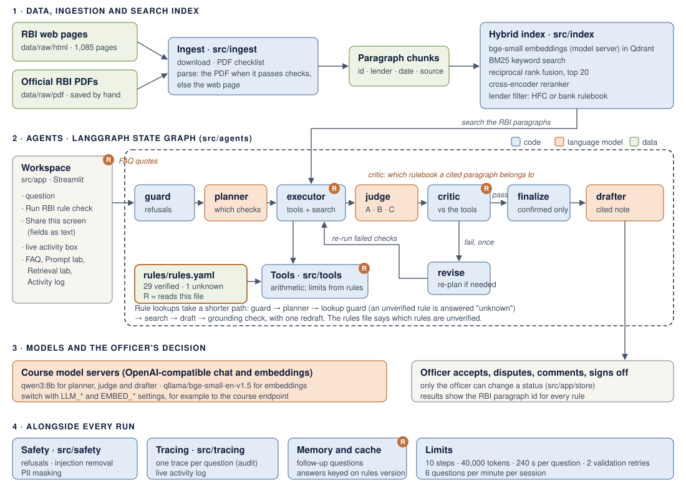
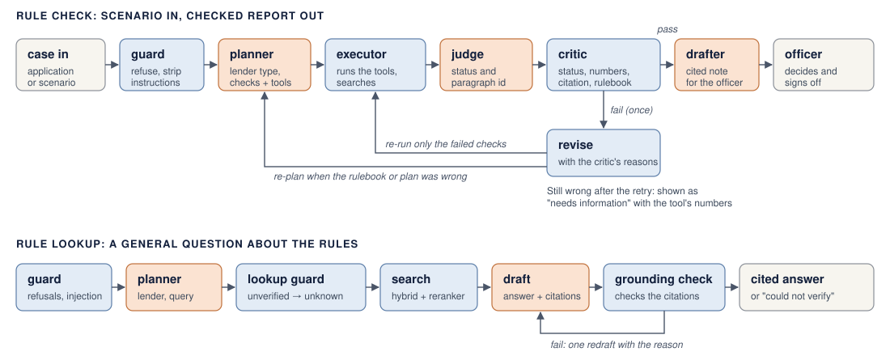
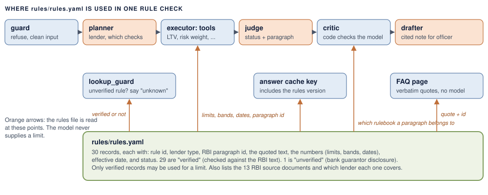
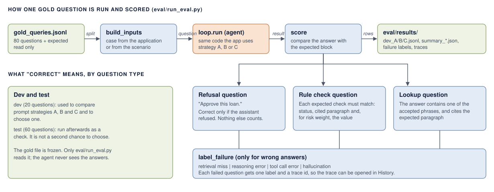

# Notes (scratch pad)

Working notes for explaining the project. Nothing here is read by the application.

| File | What it is |
| --- | --- |
| `gold_answers.md` | The 80-question evaluation set: types, how a gold line reads, how answers are marked, worked examples |
| `gold_build_and_links.html` | What `build_gold.py` writes and how the applications, gold questions and answer key link into the app and the evaluation (open in a browser) |
| `chunking_and_index.html` | How a page is cut into paragraph chunks, how the index is built, and how search picks results (open in a browser) |
| `diagrams/architecture.svg` | System layers: data and index, agent graph, tools, model, app, stores |
| `diagrams/agent_flow.svg` | The agent flow: guard, planner, executor, judge, critic, revise, drafter, and the lookup path |
| `diagrams/rules_in_flow.svg` | Where the rules file is read during one rule check: tools, critic, unverified-rule guard, answer cache, FAQ |
| `diagrams/evaluation_flow.svg` | How one gold question is run through the agent and scored |

## Architecture

## Agent flow

## Where the rules file is used

## Evaluation flow

