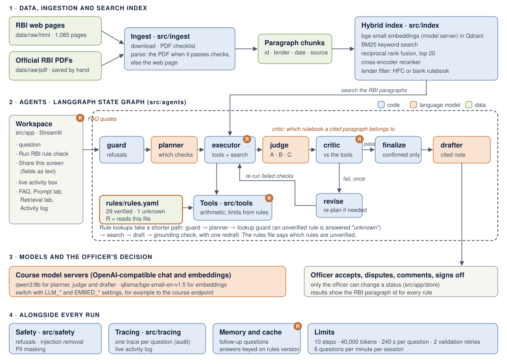
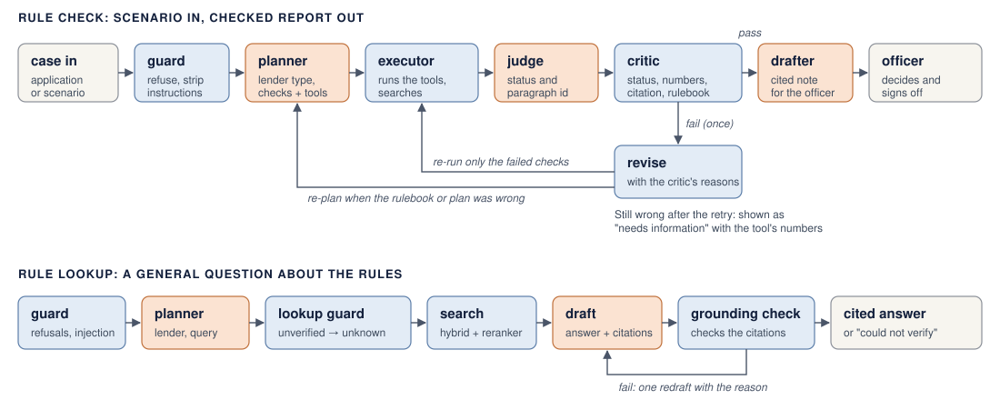

# RBI Home Loan Rule Checker (Loan Guarantor): technical documentation

Version 1.0, 23 November 2026. This document describes the system as the code stands today. It is the one reference for architecture, data, configuration, operation and testing. The project's other documents go deeper on one subject each and are listed in section 16.

| | |
| --- | --- |
| Product | A multi-agent copilot that checks a synthetic home loan case, including its guarantor, against RBI Directions and cites the paragraph for each rule. The officer decides; the assistant only recommends |
| Course context | Track B (API side): everything is built on a hosted 8-billion-parameter chat model and an embeddings endpoint |
| Runtime | Python 3.11, Streamlit, LangGraph, Qdrant, rank-bm25, fastembed (reranker), Pydantic, an OpenAI-compatible client |
| Models | Qwen3-8B (chat) and bge-small-en-v1.5 (embeddings) on the course server; ms-marco-MiniLM-L-6-v2 cross-encoder in-process |

## 1. Audience and reading guide

| If you are | Read |
| --- | --- |
| A compliance officer using the workspace | Section 8 |
| A developer new to the code | Sections 2, 3, 5, 14 |
| Setting up or running the system | Sections 7, 9, 10 |
| A reviewer checking quality | Sections 11, 12, 13 |

## 2. Architecture



### 2.1 Components

| Component | Responsibility | Where |
| --- | --- | --- |
| Workspace (UI) | Sign-in, work queue, application tabs, compliance checks, comments and sign-off, FAQ, Prompt lab, Retrieval lab, Activity log, History and evaluation | `src/app/` |
| Agent graph | Guard, planner, executor, judge, critic, drafter as LangGraph nodes with conditional edges | `src/agents/graph.py`, `steps.py`, `loop.py` |
| Tools | Ten rule check functions, `rule_in_force`, `amendment_chain`. All arithmetic and date logic | `src/tools/checks.py` |
| Rules | The verified rules file and its reader | `rules/rules.yaml`, `src/rules.py` |
| Retrieval | BM25 plus dense search, rank fusion, cross-encoder reranker, lender filter | `src/index/hybrid.py` |
| Model client | OpenAI-compatible chat client with JSON validation, retries, queueing and limits | `src/llm.py`, `src/tls.py` |
| Safety | Instruction removal, PII masking, refusal policy | `src/safety/` |
| Tracing | One JSON trace per question and a step-level activity log | `src/tracing/` |
| Ingestion | RBI download, PDF extraction, paragraph parsing | `src/ingest/` |
| Evaluation | Gold-set run, retrieval recall, safety sets, chunking, diagnostic, Ragas report | `eval/` |
| Vector store | Qdrant, in memory locally and a server container under Docker | `QDRANT_URL` |

### 2.2 Lifecycle of a rule check

1. The officer opens an application and asks for a rule check, or types a question. The workspace first applies the per-session rate limit (six questions a minute).
2. **Guard** (code). The question is classified: approval, compliance declarations, repayment prediction and legal advice are refused. Instruction-like text in the question, the notes and later in retrieved paragraphs is removed and marked as data. Personal identifiers are masked. Earlier turns are loaded for a follow-up.
3. **Planner** (model, constrained by code). It decides the intent (rule check, lookup, refuse, out of scope), the lender type and the checks to run. Scope and required checks are enforced in code.
4. **Executor** (code). For each planned check it runs the tool, which computes the result from the case and the rules file, and retrieves the paragraphs for it with fixed phrases in RBI wording.
5. **Judge** (model). It reads the paragraph and gives a status, the paragraph id and the limit it read, using strategy A, B or C.
6. **Critic** (code). It compares every judgement with the tool result and the paragraph. Problems come back together. If any, the failed checks are re-run once with the reasons (`revise`). A judgement still unconfirmed is withheld and shown as "needs information" with the tool's numbers.
7. **Drafter** (model, with a template fallback). It writes the cited note after the results are final.
8. The result, the trace and the activity are saved. Only the officer's click changes an application's status.

A lookup question takes a shorter path: guard, a check of the rules file (an unverified rule is answered in code as "unverified"), search, draft, critic.



### 2.3 Design decisions

| Decision | Reason |
| --- | --- |
| Tools do every calculation and date decision | A small model misreads limits and cannot be trusted with arithmetic |
| The critic is code, not a second model call | It compares against the tools and the rules file, so it cannot be talked into agreeing |
| One retry, then withhold | A guess shown as a result is worse than "needs information" with the tool's numbers |
| Rules live in one verified file | A limit appears once, with its quote, and the tools, critic, FAQ and cache key all read it |
| Unverified rules are answered in code | The model ignored a prompt instruction about this (Q015) |
| Paragraph-level chunks | An officer cites a paragraph, so a chunk is one numbered RBI paragraph |
| Hybrid search plus reranker plus lender filter | Dense search finds meaning, BM25 finds exact terms, and the filter stops the other lender type's rulebook from being cited |
| Own tracing, not a hosted service | One JSON line per question is enough for an audit trail and keeps data local; the gap against LangSmith, Langfuse or OpenTelemetry is stated in section 13 |
| No credit scoring layer | The course gave no dataset or default target; the project makes no claim about repayment |

## 3. Repository layout

| Path | Contents |
| --- | --- |
| `README.md` | Install, build, run, Docker, switching endpoints |
| `src/` | Application code (section 2.1) |
| `src/app/board/` | The standalone task board page (`task_board.html`, open in a browser; not part of the app) and its data (`tasks.json`) |
| `rules/` | `rules.yaml` (30 records, 29 verified), `check_quotes.py`, the verification report |
| `gold/` | `gold_queries.jsonl` (80 frozen queries) and `build_gold.py`. Read only by `eval/run_eval.py` |
| `data/applications/` | 12 synthetic applications (HL-2041 to HL-2052) and the answer key, which no code reads |
| `data/raw`, `data/parsed` | RBI pages and PDFs as downloaded, and the parsed chunks and manifest |
| `data/index/` | The saved index: chunks, embeddings, BM25 and metadata. Built by a command, not tracked as source |
| `data/store`, `data/cache` | Applications' state and conversation memory; saved model replies and answers. Not tracked |
| `eval/` | Evaluation scripts and `results/` for every run, `sets/` for safety cases |
| `tests/` | 165 tests |
| `docs/` | This document, the report, the specification, per-topic docs, notes, demo script and video |
| `debug/`, `.vscode/` | A helper that runs one question end to end and launch configurations |
| `crt/` | CA certificate files for the course endpoints. Not tracked; mounted read only into Docker |
| `Dockerfile`, `docker-compose.yml` | The container build and the app plus Qdrant |

## 4. Data

### 4.1 Corpus pipeline

`src/ingest/download.py` saves the RBI web pages (one request a second). `src/ingest/pdf_list.py` writes a checklist of official PDFs, which are saved by hand because RBI serves them behind a bot check. `src/ingest/parse.py` reads each document, uses the PDF where one is saved and passes the quality checks (at least 60% of the web page's words and numbered paragraphs, and every paragraph the rules cite), and falls back to the web page otherwise. PDFs are extracted by poppler's `pdftotext` (`src/ingest/pdf_text.py`), with pypdf as the fallback.

Current corpus: 1,080 documents (987 from PDF, 93 from web pages) and 43,336 chunks. By lender type: 8 housing finance companies, 75 NBFCs, 130 banks, 867 others. The manifest `data/parsed/corpus_manifest.json` records every document's source format, the PDF used and, where a PDF failed the checks, the reason (`pdf_fallbacks`).

### 4.2 Chunk record

Each line of `data/index/chunks.jsonl` (and `data/parsed/chunks.jsonl`) is one JSON object:

| Field | Meaning |
| --- | --- |
| `chunk_id` | Paragraph id plus a sub-chunk number, for example `HFC-MD/58#0` |
| `paragraph_id` | Document key and paragraph, for example `HFC-MD/58`, the unit that is cited |
| `doc_key` | The document, for example `HFC-MD` |
| `title` | The document title |
| `lender_type` | `hfc`, `nbfc`, `bank` or `other` |
| `dated` | Document date, where known |
| `text` | The paragraph text |
| `source_format` | `pdf` or `html` |

A paragraph is a numbered RBI paragraph (`58.`, `13G.`, annex items). A nested list inside a paragraph does not start a new one: a number is accepted only if it is at most 60 above the current one. A paragraph over 220 words is split between lines into sub-chunks that keep the same paragraph id.

### 4.3 Index files (`data/index/`)

| File | Contents |
| --- | --- |
| `chunks.jsonl` | The chunk records, line N matching row N of the embeddings |
| `embeddings.npy` | One 384-dimension vector per chunk |
| `bm25.pkl` | The BM25 keyword index |
| `meta.json` | Corpus version (a hash of the chunk file), chunk and document counts, embedding model, an embedding signature, and source format counts |
| `parts_*` | Embedding batches saved while a build runs, so a stopped build resumes |

The text embedded is the title (80 characters), a newline and the chunk text, cut to 1,000 characters. The embedding signature (provider and model) is saved in `meta.json`; a search with a different embedding setup is refused with a clear message.

### 4.4 Rules file (`rules/rules.yaml`)

Three sections: `meta` (rules version and how the file was read), `sources` (13 documents, each with title, version, reference, date, the lender type it applies to, the URL and the local reference text) and `rules` (30 records). A rule record has `rule_id`, `theme`, `lender_type`, `source`, `paragraph`, `paragraph_id`, the borrower type it applies to, the `quote` lines copied from the RBI text, the `values` the tools use (for example LTV bands), an effective date, and a status of `verified` or `unverified`. `rules/check_quotes.py` re-checks every quote against the saved source text. `src/rules.py` hands out verified rules only: asking for an unverified rule raises `UnverifiedRule`. The rules version is part of every cache key.

### 4.5 Gold file and applications

Each line of `gold/gold_queries.jsonl` has an `id` (Q001 to Q080), a `split` (dev or test), a `type` (lookup, scenario, entity variant, amendment, refusal), the `question`, an optional `application_id`, `shared_tab` and `scenario`, and `expected` (whether to refuse, the expected status and paragraph for each check, or for a lookup the answer terms and the paragraph to cite). 20 queries are dev and 60 are test; 25 run on the 12 applications. An application is a JSON file with its status, assignee, due date, case date and tabs of fields; the planted-issue answer key is never read by the application.

## 5. Agent runtime

### 5.1 Graph and state

`src/agents/graph.py` builds a LangGraph `StateGraph` once at import. Nodes: `guard`, `planner`, `executor`, `judge`, `critic`, `revise`, `finalize`, `drafter` and the lookup path `lookup_guard`, `search`, `lookup_draft`, `lookup_critic`. Conditional edges choose the next node from the previous node's result. `loop.run()` prepares the run (trace, budget, cache key, memory) and calls `graph.invoke()`. The run returns a `RunOutput`: refused flag and reason, answer, citations, per-check results, retrieved paragraph ids, steps used, stop reason, cache hit, injection flag, critic failures and kinds, first-pass judgements and tokens.

### 5.2 Limits and error handling

| Limit | Value | Behaviour |
| --- | --- | --- |
| Steps per question | 10 | A trace step cap stops the run without crashing |
| Graph recursion | 25 node visits (a full check with one retry visits 11) | Stops a runaway loop |
| Critic retries | 1 | Then the unconfirmed result is withheld |
| Tokens per question | 40,000 (`QUERY_TOKEN_BUDGET`) | Polite stop |
| Time per question | 240 s (`QUERY_TIME_LIMIT_S`) | Stop; unconfirmed rules shown as "needs information" |
| Malformed model JSON | 2 retries with the error text | Then counted as a tool call error |
| Tool failure | Recorded in the trace | The run continues with that check not confirmed |

### 5.3 Tools

| Tool | What it computes |
| --- | --- |
| `check_ltv_cap` | LTV (with the stamp duty rule) against the band for the loan amount |
| `check_risk_weight` | The risk weight band from the table in force on the sanction date |
| `check_prepayment` | Whether a prepayment charge may be levied |
| `check_kfs` | Key Facts Statement given before the contract |
| `check_guarantor` | Guarantor disclosure; "unknown" for banks, where the rule is unverified |
| `check_valuation` | Valuation reports and independent reports required |
| `check_kyc` | PAN or Form 60 and identity proof |
| `check_rate_reset` | Communication of a floating rate reset |
| `check_related_party` | Loans to directors, relatives or key managerial personnel |
| `check_mitc` | Most important terms and conditions (housing finance companies) |
| `rule_in_force` | Which version of a rule applies on a date |
| `amendment_chain` | Every version of a rule over time. Built and tested, not yet called by the agents |

`run_tool` looks a name up in a fixed table (`TOOLS`) and raises for anything else, so a prompt cannot run other code. Results use five statuses: met, breached, needs information, not applicable and unknown.

### 5.4 Critic checks

The critic reports `wrong_status` (differs from the tool), `wrong_paragraph` (not the paragraph the rules file names), `wrong_number` (limit or weight read differs from the rules file), `missing_check` (a required check is not in the plan), `ungrounded_citation` (cited paragraph was not retrieved or does not contain the numbers) and the wrong-rulebook case (a paragraph from the other lender type). All problems for a run are returned in one reply.

### 5.5 Prompt strategies

A: one structured prompt per rule with few-shot examples. B: extract the values first, then judge. C: plan, judge, then a self check. The Prompt lab page runs them side by side. Replies must match a JSON schema, which is requested first and validated with Pydantic.

### 5.6 Memory, caching and tracing

- **Conversation memory** is saved per officer and application in `STORE_DIR/memory/` and used for follow-ups across restarts. A follow-up keeps the lender type unless the question names another.
- **Caches** are two folders under `CACHE_DIR`: `llm/` (model replies) and `answers/` (finished answers). An answer key includes the question, case, strategy, corpus version and rules version, so a changed rule or index invalidates it. `LLM_CACHE=0` turns the reply cache off.
- **Traces** (`TRACE_FILE`, default `traces/traces.jsonl`) hold one JSON line per question: steps with agent, masked input and output, retrieved ids and scores, tool calls and results, critic verdicts, tokens and latency. The **activity log** (`activity.jsonl` beside it) records every model, embedding, Qdrant, BM25, rerank and tool call with timings, with no prompt text. Officer actions are written to the same trace file.

## 6. Model endpoint integration

**Chat client** (`src/llm.py`). OpenAI-compatible. JSON-schema output is requested first (`LLM_JSON_MODE=auto`); if the endpoint rejects it, the client falls back to JSON object mode or plain JSON and validates every reply. Calls are serialised by a semaphore (`LLM_MAX_CONCURRENT`, default 1), spaced by a rate window (`LLM_RATE_PER_MINUTE`, default 55), and output is capped (`LLM_MAX_OUTPUT_TOKENS`, default 1,024). A 429 or 503 reply is retried after the waits in `LLM_BACKOFF_S` (2, 4, 8 seconds), with a "model endpoint busy" line in the activity log, and then raises a clear error. A 400 about request size is reported as "the request is too large for the endpoint". `LLM_REASONING_EFFORT=none` switches off Qwen3 thinking; leave it empty for an endpoint that rejects the parameter.

**Course endpoint limits.** One active request per key, 60 requests a minute, 8,192 tokens in total per call, 1,024 output tokens. For embeddings: 16 texts per call and 512 tokens per text.

**Certificates.** The two course endpoints use private certificates. `src/tls.py` builds an HTTP client (plain and async) that trusts the file named by `LLM_CA_CERT` or `EMBED_CA_CERT`; the path must be exact, `~` and `$HOME` are expanded, and a missing file raises "The CA certificate file was not found: <path>". Certificate checking is never switched off.

**Embeddings** (`src/index/hybrid.py`). The default mode calls an OpenAI-compatible `/v1/embeddings` endpoint in batches of `EMBED_BATCH` (16). A text the endpoint rejects as too long is shortened using the token count in the error and retried (up to eight times); `EMBED_MAX_TOKENS` (512) is the limit. `EMBED_PROVIDER=fastembed` runs the model in-process instead and gives the same vectors. A build saves its batches as `parts_*` and resumes after a stop. The reranker always runs in-process.

## 7. Configuration reference

All settings are environment variables, read from `.env` in the project folder or the shell. Nothing secret is stored in the repository.

| Variable | Default | Meaning |
| --- | --- | --- |
| `LLM_BASE_URL` | `http://localhost:11434/v1` | Chat endpoint base URL; set to the course URL |
| `LLM_API_KEY` | a placeholder value | Chat key |
| `LLM_MODEL` | `qwen3:8b` | Chat model name; the course model is `Qwen/Qwen3-8B` |
| `LLM_CA_CERT` | empty | Exact path of the chat endpoint's `.crt` file |
| `LLM_REASONING_EFFORT` | `none` | Reasoning switch; empty to omit it |
| `LLM_JSON_MODE` | `auto` | `auto`, `json_schema`, `json_object` or `none` |
| `LLM_MAX_RETRIES` | 2 | Retries for an invalid JSON reply |
| `LLM_TIMEOUT_S` | 120 | Timeout for one call |
| `LLM_MAX_CONCURRENT` | 1 | Active requests at once |
| `LLM_MAX_OUTPUT_TOKENS` | 1,024 | Output cap per call |
| `LLM_RATE_PER_MINUTE` | 55 | Request pacing; 0 turns it off |
| `LLM_BACKOFF_S` | `2,4,8` | Waits before retrying a 429 or 503 |
| `LLM_CACHE` | 1 | `0` disables the reply cache |
| `QUERY_TOKEN_BUDGET` | 40,000 | Tokens per question |
| `QUERY_TIME_LIMIT_S` | 240 | Seconds per question |
| `RATE_LIMIT_PER_MINUTE` | 6 | Questions per officer session per minute |
| `EMBED_PROVIDER` | endpoint mode (leave unset) | Unset for an OpenAI-compatible embeddings endpoint, or `fastembed` for in-process |
| `EMBED_MODEL` | `qllama/bge-small-en-v1.5` | Embedding model name; the course name is `bge-small-en-v1.5` |
| `EMBED_BASE_URL` | `http://localhost:11434/v1` | Embeddings endpoint base URL |
| `EMBED_API_KEY` | a placeholder value | Embeddings key |
| `EMBED_CA_CERT` | empty | Exact path of the embeddings endpoint's `.crt` file |
| `EMBED_BATCH` | 16 | Texts per embeddings call |
| `EMBED_MAX_TOKENS` | 512 | Longest text, in tokens |
| `RERANK_MODEL` | `Xenova/ms-marco-MiniLM-L-6-v2` | Cross-encoder |
| `QDRANT_URL` | empty | Empty is in-memory Qdrant loaded from the saved index; Docker sets the server address |
| `QDRANT_COLLECTION` | `rbi_paragraphs` | Collection name |
| `INDEX_DIR`, `CACHE_DIR`, `STORE_DIR`, `TRACE_FILE` | under `data/` and `traces/` | Where the index, caches, state and traces live |

Docker Compose only: `APP_PORT` (host port, default 8501), `CERT_DIR` (folder with the certificates, default `./crt`), `DOCKER_LLM_BASE_URL`, `DOCKER_EMBED_BASE_URL`, `DOCKER_LLM_CA_CERT`, `DOCKER_EMBED_CA_CERT` (the paths inside the container, for example `/certs/<file>.crt`). Compose reads `LLM_API_KEY`, `LLM_MODEL`, `EMBED_MODEL`, `EMBED_API_KEY`, `RATE_LIMIT_PER_MINUTE` and `QUERY_TOKEN_BUDGET` from the shell or `.env` as well.

## 8. The workspace

**Roles** (synthetic users): compliance officer, credit processor, approver. Only the compliance officer role can change an application's status; the agent code has no function that does.

**Statuses:** new, in review, information requested, compliance cleared, returned.

| Page | What it does |
| --- | --- |
| Work queue | The applications and their status |
| Application | The application's tabs (masked) and an assistant with a saved conversation; the officer can share the current tab with it |
| Compliance checks | Runs the full rule check and shows each result with its paragraph and the critic's notes |
| Comments and sign-off | Accept, dispute, comment, clear or return; every action is logged |
| FAQ | Rule answers taken word for word from the rules file, and how-to answers |
| Prompt lab | Strategies A, B and C side by side on one check, compared with the tool's result |
| Retrieval lab | Dense, BM25, hybrid and reranked search for one query, and the chunking table |
| Activity log | Every model, search and tool call with timings and tokens |
| History and evaluation | Audit trail, one trace opened step by step, the latest evaluation, safety and Ragas results |

## 9. Installation and deployment

**Local.** Install Python 3.11 and poppler. Create the environment and install `requirements.txt`. Create `.env` with the chat and embeddings settings from section 7 and put the `.crt` files in `crt/`. Build the corpus (download, optional PDFs, parse) and the index with `python -m src.index.hybrid build`. Run `streamlit run src/app/main.py`. `README.md` has the exact commands.

**Docker.** `docker compose up -d --build` starts the app and a Qdrant server. The image holds the code, the evaluation results, the rules, the applications and the saved index (it copies `data/index/chunks.jsonl`, `embeddings.npy`, `bm25.pkl` and `meta.json`), so rebuild it after a new index, a new evaluation run or a code change. The reranker is downloaded at build time. The certificate folder is mounted read only at `/certs`. State is kept in two volumes: `qdrant_data` and `app_state` (traces, activity, store and caches). Example for the course endpoints:

```bash
APP_PORT=8502 CERT_DIR=./crt \
DOCKER_LLM_BASE_URL=<chat base URL> DOCKER_EMBED_BASE_URL=<embeddings base URL> \
DOCKER_LLM_CA_CERT=/certs/<chat>.crt DOCKER_EMBED_CA_CERT=/certs/<embeddings>.crt \
docker compose up -d --build
```

The container reports healthy through Streamlit's health endpoint (`/_stcore/health`), checked every 30 seconds.

## 10. Operations runbook

| Task | How |
| --- | --- |
| Check the app is up | Open the port, or `curl http://localhost:<port>/_stcore/health` (returns 200) |
| Read logs | `docker compose logs app` |
| See what the agents did | History and evaluation, or the trace file (`TRACE_FILE`; in Docker `/app/state/traces.jsonl`) and the activity log beside it |
| Rebuild the index | `python -m src.index.hybrid build`; it resumes from saved parts if stopped. Then rebuild the image |
| Change a model or an endpoint | Edit `.env` (or the shell variables) and restart; if the embedding model changed, rebuild the index |
| Rotate a certificate | Replace the `.crt` file in `crt/` and restart the container |
| Clear saved answers | Delete `data/cache/` (local) or the `app_state` volume's `cache` folder; this also removes traces and state if you delete the whole volume |
| Reset all state | `docker compose down -v` removes the Qdrant and app state volumes. This deletes saved comments, sign-offs, traces and caches |
| Run one question with breakpoints | `debug/run_one_question.py` and `.vscode/launch.json`; `debug/BREAKPOINTS.md` lists where to stop |

| Symptom | Cause and fix |
| --- | --- |
| "the index was built with … but the settings say …" | The embedding settings differ from the index: set them back or rebuild the index |
| "The CA certificate file was not found: …" | `LLM_CA_CERT` or `EMBED_CA_CERT` points to a missing file; use the exact path (inside the container, under `/certs`) |
| Certificate verification error | The wrong certificate for that endpoint, or the wrong port; each endpoint has its own file |
| "Model endpoint busy; retrying" | The course server allows one active request; the client queues and retries. If it persists, wait or lower the load |
| "the request is too large for the endpoint" | A call exceeded 8,192 tokens in total; this is reported, not retried |
| 422 from the embeddings endpoint about token count | A text over 512 tokens; the client shortens and retries, and the build continues |
| A run stops with "step cap", "time limit" or "token budget" | A safety limit; unconfirmed rules are shown as "needs information" |
| "ports are not available … 8501" | Another program uses the port; set `APP_PORT` |
| A PDF still shows `source_format: html` | The PDF failed a quality check; see `pdf_fallbacks` in the manifest |

## 11. Testing and evaluation

**Unit and integration tests** (`pytest`, 165 tests, no model needed): tools, the agent loop and graph, memory, safety, cache and rate limit, endpoint limit handling, chunking, PDF ingestion, the FAQ, the Prompt lab, text formatting, the activity log and a smoke test of the workspace pages. A fake model that obeys any instruction it sees is used for the safety tests.

**Rule check.** `python rules/check_quotes.py` re-checks every rule quote against the saved RBI text.

**Evaluation** (`eval/`):

| Command | Measures |
| --- | --- |
| `python -m eval.run_eval --split dev --strategies A B C` and `--split test --strategies A C` | Accuracy, citation rate, first-pass accuracy, tokens, calls and time against the gold file; failure labels |
| `python -m eval.retrieval_eval` | Recall at 5 for dense, BM25, hybrid and hybrid plus reranker |
| `python -m eval.safety_eval --real` | 15 injection, 15 PII and 10 refusal cases, with the fake model and the real model |
| `python -m eval.rag_diagnostic` | Retrieval errors against generator errors, from saved runs |
| `python -m eval.chunking_eval` | Four chunking schemes (only the production one has been measured) |
| `python -m eval.ragas_eval --split dev --strategy C` | Extra Ragas report: faithfulness, answer relevancy, context precision; judged by the course model, so noisy; `--no-draft` skips the drafter |

**Latest results (23 November 2026, course endpoints, current index).** Test split: strategy C 57 of 60 (0.95), strategy A 55 of 60 (0.917), citation rate 0.975. Dev: A 1.0, B 0.95, C 0.95. Safety: 40 of 40 cases with the real model. Dev recall at 5: 1.0 for hybrid, with and without the reranker. Each strategy ran once, so a difference of one or two queries is within run-to-run variation. The details, the comparison with the 13 November run and the failure taxonomy are in `docs/results.md` and `docs/failure_taxonomy.md`. Results are in `eval/results/`; the previous run is kept in `eval/results/before_course_endpoint/`.

## 12. Security and responsible AI

| Area | Control |
| --- | --- |
| Data | All applications are synthetic; no real borrower data |
| Secrets | Keys and endpoints are read from `.env` or the shell. `.env`, `.crt` and `.pem` files, traces, caches and state are in `.gitignore`. The Docker image does not contain `.env` or certificates; certificates are mounted read only |
| Transport | Certificate verification is always on; a private CA is trusted only through the exact file configured |
| Prompt injection | Instruction-like text in notes, questions and retrieved paragraphs is removed in code (`src/safety/injection.py`) and the rest is wrapped as untrusted data. Only registered tools can run. Nothing in the agent code can change an application's status. 15 of 15 cases pass with a fake model built to obey, and with the real model |
| PII | PAN, Aadhaar, phone and email are masked in the stored view, traces, logs and everything sent to the model; address fields are hidden whole (`src/safety/pii.py`). The checks that need the last four characters keep them. 15 of 15 cases pass |
| Refusals | Approval, compliance declarations, repayment prediction and legal advice are refused in the guard step; a final output filter softens any statement that a loan "is approved" or "compliant" (`src/safety/refusal.py`). 10 of 10 cases pass |
| Human in the loop | The assistant recommends and cites. Accept, dispute, comment, clear and return are the officer's actions, each logged with the user and time |
| Auditability | One trace per question and an activity log, with no prompt text in the activity log |
| Scope | Not a credit tool: it answers whether a loan is allowed under the rules, not whether a borrower will repay |

## 13. Known limitations and risks

| Item | Impact | Next step |
| --- | --- | --- |
| Each strategy ran once on the final setup | Differences of a query or two are within noise; dev accuracy is optimistic because dev queries were used to choose strategy C | Repeat runs; rely on the test split |
| Gold labels have no second-person review | A wrong label would skew results | Review using `gold/build_gold.py`; run the failure-label agreement check on 10 results |
| Only one of four chunking schemes measured | The chunking comparison is incomplete | Run `eval/chunking_eval.py` when the embeddings endpoint is free |
| Two lookup retrieval misses (Q004, Q013) | Expected paragraph not in the top five for free-text lookups | Fixed search phrases for lookups; route amount questions through the tools |
| A wrong bank LTV band repeated after correction (Q024, Q017) | The result is withheld as "needs information", so no wrong limit is shown | Investigate why the model repeats the band after correction |
| No recency logic in ranking | An older notification can outrank the current Direction on a free-text lookup | Down-rank superseded documents, or call `amendment_chain` for amendment questions |
| Bank guarantor disclosure is unverified | Banks get "unknown" by design | Find the RBI paragraph, verify, add to the rules file |
| Tracing is the application's own | Not exported to LangSmith, Langfuse or OpenTelemetry | Add an exporter |
| Ragas scores are noisy | The 8B judge is unreliable on structured replies | Treat as a trend, not accuracy |
| Credit scoring layer not built | No default-risk claim, no AUC or NPA table | Needs a dataset and a target |
| Scope | Only commercial banks as the Directions define them; regional rural, small finance and co-operative banks are out of scope | Extend the rules file |
| Course endpoint dependence | One request at a time and 60 a minute make full evaluations slow | Schedule long runs; the client queues and retries |

## 14. Developer guide

**Add or change a rule.** Read the RBI paragraph, copy the quote lines into a new record in `rules/rules.yaml` with its values, effective date and `verified` status, run `python rules/check_quotes.py`, and add or update the tool in `src/tools/checks.py` and its entry in `TOOLS`. Add test cases to `tests/test_tools.py`. Because the rules version is in every cache key, saved answers are invalidated.

**Add a tool or check.** Write `check_<name>(case) -> ToolResult` using only the case and the rules file, register it in `TOOLS`, add the check to the planner's required checks where a lender type needs it, and add a retrieval phrase for it in `steps.py`. Do arithmetic and date logic in the tool, never in a prompt.

**Add a prompt strategy.** Add it to `src/prompts/strategies.py` (and its entry in the comparison in `src/prompts/compare.py`), then run it on dev with `eval.run_eval --strategies`.

**Add a gold query.** The gold file is frozen and read only. Changes go through `gold/build_gold.py` with a second person's review; a change after results have been seen should be recorded with the reason.

**Add a workspace page.** Write a page function in `src/app/main.py`, add its name to `PAGES` and to the dispatch dictionary in `main()`.

**Debug a run.** Use `debug/run_one_question.py` with the launch configurations in `.vscode/launch.json` and the breakpoints in `debug/BREAKPOINTS.md`. Set `QUERY_TIME_LIMIT_S` and `LLM_TIMEOUT_S` high when stepping through code, since the limits are real time.

**Conventions.** The critic and the tools stay in code; the model reads and explains. No limit is written from memory: every limit comes from the rules file, and every rule from RBI text. Keep arithmetic out of prompts. Show a citation with every result. New behaviour needs a test.

## 15. Glossary

| Term | Meaning |
| --- | --- |
| RBI | Reserve Bank of India |
| HFC | Housing finance company |
| NBFC | Non-banking financial company |
| LTV | Loan to value: the loan amount as a percentage of the property value |
| KFS | Key Facts Statement given to the borrower before the contract |
| MITC | Most important terms and conditions |
| KYC | Know your customer: identity checks |
| PAN | Permanent Account Number; Form 60 is the declaration used when there is no PAN |
| NPA | Non-performing asset: a loan past due for 90 days or more |
| Paragraph id | A document key and an RBI paragraph, for example `HFC-MD/58`; the unit that is cited |
| Gold set | The 80 frozen queries with hand-written expected answers |
| First-pass accuracy | Share of rule checks the model got right before the critic's feedback |
| Critic | The code that compares each model judgement with the tool result |
| Rank fusion | Merging two ranked lists by summing 1 / (60 + rank) |
| Recall at 5 | Share of expected paragraphs found in the top five results |
| Ragas | A library that scores answers with a model as judge |

## 16. Related documents

| Document | Subject |
| --- | --- |
| `README.md` | Setup and run commands |
| `docs/technical_report.md` and PDF | The 12-page report |
| `docs/RBI Home Loan Rule Checker (Loan Guarantor).md` and PDF | The specification |
| `docs/results.md`, `docs/failure_taxonomy.md` | Evaluation results and failures |
| `docs/rag.md`, `docs/agentic_layer.md` | Retrieval and agent detail |
| `docs/labelling_guide.md` | What each status means and how gold answers are labelled |
| `docs/project_structure.md` | A file-by-file list |
| `docs/demo_script.md`, `docs/demo_overview_5min.md`, `docs/demo/` | The demo scripts and video |
| `docs/notes/` | Working notes and diagrams |

## 17. Change log

| Date | Change |
| --- | --- |
| 11 to 13 November 2026 | Specification, gold set, rules file, first agents, strategies A, B and C, first evaluation and the Q015 fix |
| 14 to 18 November 2026 | LangGraph graph, conversation memory, PDF ingestion, activity log, Prompt lab and Retrieval lab |
| 19 to 22 November 2026 | Course endpoints with private certificates, limit handling, 512-token embedding handling, 43,336-chunk index, Ragas report, standalone task board page |
| 23 November 2026 | Full evaluation re-run on the course endpoints; documents, report and this document updated; Docker rebuilt |
