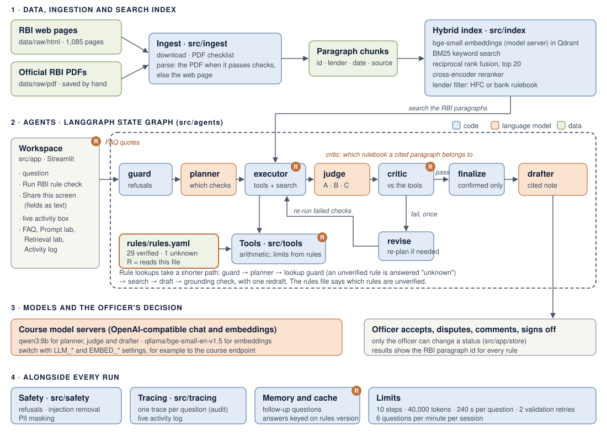

# RBI Home Loan Rule Checker (Loan Guarantor): technical report

Track B capstone, "Multi-Agent Operations Copilot built entirely on a hosted 8B inference API". November 2026.

## 1. Summary

The assistant tests a synthetic home loan case, including its guarantor, against the Reserve Bank of India (RBI) Directions. It lists each rule as met, breached, needs information, not applicable or unknown, and cites the RBI paragraph that says so. A compliance officer reviews the result and decides. The assistant never approves a loan and never declares a lender compliant.

It is built on one small model, Qwen3-8B, behind an OpenAI-compatible endpoint, with a separate embeddings endpoint. Everything else had to be won through prompting, retrieval, tools, orchestration and evaluation, which is what the track asks for.

| What | Result |
| --- | --- |
| Corpus | 1,080 RBI documents (987 read from the official PDF, 93 from web pages), 43,336 paragraph chunks |
| Retrieval | Hybrid BM25 plus dense search, then a cross-encoder reranker; recall at 5 is 1.0 on the 26 development citations |
| Agents | LangGraph graph with six roles: guard, planner, executor, judge, critic, drafter; 10 rule tools plus search |
| Accuracy on 60 test queries | Strategy C (plan, judge, self check) 56 of 60 (0.933); strategy A (direct check) 55 of 60 (0.917). One fix was made after seeing test results (section 11) |
| Cost per query | About 7,600 tokens and 4.9 model calls; 24 seconds (strategy C), without the written note |
| Safety sets | 40 of 40 cases passed (15 prompt injection, 15 PII, 10 refusal) |
| Deployment | Streamlit workspace in Docker Compose with Qdrant; caching, rate limiting and endpoint limit handling |

On the first pass the model was right on under half of the rule checks. Every judgement is compared in code with a plain tool result and sent back once if it disagrees (section 6). Each strategy was run once on the final setup (25 November: the course model, the PDF-based corpus), so a difference of one or two queries is within run-to-run variation.

## 2. Task decomposition and the gold set

**What the assistant does and refuses.** It picks the rulebook for the lender type (housing finance company, NBFC or bank), computes the loan to value ratio (LTV), compares it with the cap, checks the risk weight band, valuation reports, prepayment charge, key facts statement, know your customer (KYC) documents, rate reset communication, related party lending and guarantor disclosure, and drafts a cited note. It refuses to approve or reject a loan, declare compliance, predict repayment, give legal advice, or use real customer data. Refusal is code in the guard step, not a request to the model.

**Written specification.** `docs/RBI Home Loan Rule Checker (Loan Guarantor).md` (also as PDF) states scope, the rules, the scenario inputs, the architecture and the refusal policy. `docs/labelling_guide.md` defines each status and how gold answers and failures are labelled. The conventions that separate "breached" from "needs information" are written there and are also given to the model.

**The gold set.** There are 80 queries, frozen before any agent code was written: 15 rule lookups, 30 scenario checks, 15 lender-type variants, 10 amendment questions and 10 refusal or injection queries. Twenty are for development and 60 are held out for testing; 25 of the 80 run on 12 synthetic applications (HL-2041 to HL-2052). Every expected answer was typed by hand from the verified rules, not produced by the application, so a bug in the application cannot pass its own test. The builder script `gold/build_gold.py` is kept so a reviewer can check the labels. Only `eval/run_eval.py` reads the gold file.

**Verified rules.** Before any rule was used, its limit was read from the RBI text and recorded with a quote in `rules/rules.yaml`: 30 records from 13 sources, of which 29 are verified. The one unverified record is the disclosure a bank must make to a guarantor, because no RBI paragraph for banks was found. The tools and the critic read this file, so a limit appears in one place only, and a check on the unverified rule returns "unknown" instead of a guess.

## 3. Prompt engineering baseline

Three strategies were compared on the same retrieval and the same 20 development queries.

| Strategy | What it does | Dev accuracy | Tokens per query | Schema retries |
| --- | --- | --- | --- | --- |
| A. Direct check | One structured prompt per rule, with few-shot examples | 0.95 | 6,701 | 0 |
| B. Extract, then judge | First extract the values from the paragraph, then judge | 0.95 | 10,034 | 0 |
| C. Plan, judge, self check | Plan the checks, judge each, then check its own judgement | 0.95 | 7,429 | 0 |

The table is the 25 November run. Strategy C was chosen on the development queries before the final run; in this run all three tie on dev, and on test C is one query ahead of A, which is within run-to-run variation. B used about 35% more tokens than C and had the lowest first-pass accuracy.

**How the small model breaks.**

- **It reads the wrong band.** With every LTV band in the paragraph, it gives the limit of the next band, for example 80% where the rules file gives 90% for a bank loan of up to ₹30 lakh (Q024, Q017), repeated after correction.
- **It cites a paragraph that does not hold the rule.** On the test split in the latest run, 49 first-pass judgements under A and 33 under C cited the wrong paragraph. All were corrected by the critic.
- **It misses the second condition of a rule.** On HL-2048 (₹78 lakh, two valuation reports, one independent) every strategy saw two reports and judged the valuation rule met. Annex V requires both to be independent above ₹75 lakh. The Prompt lab page shows this live.
- **It ignores instructions in the prompt.** Told a rule is unverified, it answered from an unrelated capital adequacy paragraph (Q015). On a follow-up it kept the lender type from the history instead of the one asked about.
- **It repeats a mistake after being corrected.** Both strategies did this on Q024, and on Q016 and dev query Q017.
- **Long structured replies are cut off.** Strategy B's extract reply ran out of output tokens in the middle of a string and failed validation three times (Q022, dev).

First-pass accuracy, the share of rule-check queries where the model was right on every expected rule before any feedback, was 0.15 to 0.31 on dev and 0.40 to 0.44 on test.

## 4. Retrieval over a real corpus

**Corpus.** 1,080 documents from rbi.org.in: 8 for housing finance companies, 75 for NBFCs (several apply to housing finance companies), 130 for banks and 867 others (foreign exchange, payments, markets). The others are kept on purpose: the right paragraph must be found among unrelated RBI text. The corpus version is a hash of the chunk file (`6074ba19e620`); the answer cache and the vector collection are keyed on it.

**PDF ingestion.** Every RBI document has an official PDF, and some web page text is incomplete or carries site menus. The parser uses the PDF where one has been saved and passes quality checks (at least 60% of the web page's words and numbered paragraphs, and every paragraph the rules cite), and falls back to the web page otherwise. In the current index 987 documents come from PDFs and 93 from pages. Text is extracted with poppler's `pdftotext`, which kept words and a risk weight table cell that pypdf lost. A chunk from a PDF keeps the paragraph id the rules cite (for example `CB-CF/111`).

**Chunking.** The production scheme is paragraph-aware: each numbered RBI paragraph is one chunk, the unit an officer cites. A paragraph longer than 220 words is split between lines into sub-chunks that keep the same paragraph id, and a nested list inside a paragraph does not start a new one. Each chunk carries its paragraph id, document, title, lender type, date and source format. Four schemes are defined for comparison (paragraph at 220 words, paragraph at 120, fixed 200-word windows, fixed 400-word windows with an 80-word overlap), but only the production scheme has been measured; the other three are not yet run (section 11).

**Hybrid search.** A query goes to BM25 (`rank-bm25`) and to dense search (bge-small-en-v1.5 vectors in Qdrant); each returns its top 40. The two lists are merged by reciprocal rank fusion, which scores each result as 1 / (60 + rank) in each list and adds the scores. The top 20 are reranked by the cross-encoder `ms-marco-MiniLM-L-6-v2`. A lender filter limits a housing finance case to housing finance and NBFC documents and a bank case to bank documents, which stops the most damaging error in this domain: citing the other lender type's rulebook. The index records which embedding model built it and refuses to be searched with another.

**Recall measured apart from answer quality.** Recall at 5 on the 26 expected citations in the development queries:

| Mode | Recall at 5 |
| --- | --- |
| Dense only | 1.0 |
| BM25 only | 0.923 |
| Hybrid | 1.0 |
| Hybrid plus reranker | 1.0 |

On the dev queries the reranker does not change recall at 5, because dense and hybrid already reach 1.0. On the held-out test queries recall at 5 for the production scheme on the web-page index (the chunking experiment, `eval/results/chunking.json`) was 0.852 dense, 0.951 BM25, 0.951 hybrid and 0.951 hybrid plus reranker. A diagnostic (`eval/rag_diagnostic.py`) separates retrieval errors from generator errors. Rule checks search with fixed phrases in RBI wording; free-text lookups are searched as asked, which is where the two retrieval misses on the test split came from (Q004, Q013), in both runs.

**Citation-grounded answers.** Every answer cites paragraph ids. The critic rejects a citation that was not retrieved, comes from the wrong lender's rulebook, or does not contain the numbers in the answer.

## 5. The agentic layer

The flow runs on LangGraph (`src/agents/graph.py`): one node per agent step and conditional edges for the critic's verdict. The agents, tools and prompts are plain Python functions the nodes call, so the safety rules stay in code where they can be read and tested.

| Role | What it does | Model or code |
| --- | --- | --- |
| Guard | Refuses approval, compliance declarations, repayment predictions and legal advice; removes instruction-like text; masks personal identifiers; loads earlier turns for a follow-up | Code |
| Planner | Decides the intent (rule check, lookup, refuse, out of scope), the lender type and the checks to run | Model, with scope and required checks enforced in code |
| Executor | Runs the tool for each planned check and retrieves the paragraphs for it | Code |
| Judge | Reads the retrieved paragraph and gives a status, the paragraph id and the limit it read | Model (strategy A, B or C) |
| Critic | Compares each judgement with the tool result and the paragraph: status, number, citation, rulebook, missing checks. Reports every problem at once | Code |
| Drafter | Writes the cited note from the check results and the cited paragraphs; falls back to a template if the model fails | Model, with a code fallback |

**Tools.** Ten rule check tools (LTV cap, risk weight, prepayment, key facts statement, guarantor disclosure, valuation, KYC, rate reset, related party, most important terms and conditions) plus the hybrid search tool and a `rule_in_force` tool that returns which version of a rule applies on a date. Only registered tools can run: `run_tool` looks the name up in a fixed table and raises for anything else, so a prompt cannot make other code run. All arithmetic and date logic lives in the tools.

**The loop.** After the guard and the planner, the executor runs the tools and the judge reads the paragraphs. The critic compares every judgement with the tool result. If any disagree, the failed checks go back once to the executor with the reason (the `revise` step) and are judged again. A judgement still unconfirmed after the retry is withheld and shown as "needs information" with the tool's numbers, so a wrong limit never reaches the officer. A lookup question takes a shorter path: guard, a check of the rules file, search, draft, critic.

**Persistent state.** Conversation is saved per officer and application and reused for follow-ups, across turns and across app restarts. A follow-up keeps the lender type unless the question names another.

**Error handling.**

| Failure | Handling |
| --- | --- |
| Tool raises | Recorded in the trace; the run continues with the check shown as not confirmed |
| Malformed JSON | Reply validated with Pydantic and retried; after the retries the step counts as a tool call error |
| Endpoint rejects JSON-schema output | Client falls back to plain JSON and validates it |
| Endpoint busy (429 or 503) | Retried after 2, 4 and 8 seconds, then a clear error |
| Infinite loop | Step cap of 10 per query, one critic retry, and a LangGraph recursion limit of 25 nodes |
| Token budget | 40,000 tokens per query, then a polite stop |
| Slow run | 240 second limit per query, then a stop that shows unconfirmed rules as "needs information" |

## 6. What we did to compensate for a small model

The model reads and explains; everything that can be checked is checked in code.

1. **Tools do the arithmetic and the dates.** The model never computes LTV, never compares a number with a limit, and never decides which version of a rule applies on a date. A loan's LTV, the stamp duty adjustment and the risk weight band come from `src/tools/checks.py`.
2. **Every limit comes from a verified rules file.** The limits in `rules/rules.yaml` were read from the RBI text and recorded with a quote; `rules/check_quotes.py` re-checks every quote against the source text. The model is given the paragraph to read, but the number it is compared against comes from the file.
3. **A critic written in code compares every judgement.** It does not ask the model whether the model was right. It compares the status, the number, the paragraph, the rulebook and the list of required checks with the tool result, and reports every problem in one reply. On the test split in the latest run it sent back 32 queries under A and 29 under C. The problems found (counts of first-pass problems on the test split):

| Problem | A | C |
| --- | --- | --- |
| Status disagrees with the tool computation | 34 | 38 |
| Cited paragraph is not the one that holds the rule | 49 | 33 |
| Limit or weight read from the paragraph is wrong | 4 | 3 |
| Required check missing from the plan | 0 | 0 |

   The self check does not remove misread limits: C had 3 and A had 4, and the queries that ended unconfirmed include repeated wrong limits (Q016, Q024 on test, Q017 on dev), although the critic catches them.
4. **One retry, then withhold.** A result that cannot be confirmed after one retry is not shown as a guess. It is shown as "needs information" with the tool's numbers.
5. **Unverified rules are handled in code.** The lookup path checks the rules file before any model call, and returns "unverified" for a rule that is not verified. This replaced a prompt instruction that the model ignored (the Q015 fix, section 7).
6. **Instruction-like text is removed before the model sees it.** Notes, questions and retrieved paragraphs are scanned; text that tries to give instructions is removed and marked as data.
7. **Structure and limits on every call.** Replies must match a JSON schema, are validated and retried, and each call has a step cap, a token budget and a time limit.
8. **Retrieval is narrowed by lender type.** A lender filter and fixed search phrases for rule checks keep the model from seeing the wrong rulebook.
9. **The model drafts last and cannot change a status.** The note is written after the results are confirmed, with a template as a fallback.

The cost of this design is that final scenario accuracy mostly reflects whether the model can be brought into agreement within one retry. First-pass accuracy is the fairer measure of the model's own reading, and it is reported alongside.

## 7. Evaluation

**Ragas report (extra, model-judged).** `eval/ragas_eval.py` scores the dev answers with Ragas 0.4, with the course model as judge. The History and evaluation page shows the same figures: dev split, strategy C, written answers, judge Qwen/Qwen3-8B, run on 25 November.

| Metric | Average | Queries with no score |
| --- | --- | --- |
| **Rule lookups (against the paragraphs the drafter read) · 5 queries** | | |
| Faithfulness | 0.900 | 0 |
| Answer relevancy | 0.724 | 0 |
| Context precision | 0.961 | 0 |
| **Application checks (against the check results and cited paragraphs the drafter was given) · 13 queries** | | |
| Faithfulness | 0.769 | 0 |
| Answer relevancy | 0.614 | 0 |
| **Tool calls and goal (reference: the gold answer's rule checks) · 13 queries** | | |
| Tool recall (own figure) | 1.000 | 0 |
| Tool call F1 | 0.852 | 0 |
| Tool call accuracy | 0.692 | 0 |
| Agent goal accuracy | 0.769 | 0 |

Ragas scores are judged by the same 8B model that writes the answers, and vary between runs. They are indicative only; accuracy is measured in code against the gold answers. Tool recall, tool call F1 and tool call accuracy are compared in code; on a full application check the gold file lists only the rules it grades, so extra tool calls lower F1 and accuracy there.

Scores for each query, lookups:

| Query | Question | Faithfulness | Answer relevancy | Context precision |
| --- | --- | --- | --- | --- |
| Q002 | What does the HFC rulebook say about stamp duty in LTV for a ₹9 lakh house? | 1.00 | 0.85 | 1.00 |
| Q006 | What must a person be told before becoming a guarantor to a housing finance company loan? | 1.00 | 0.82 | 1.00 |
| Q010 | How many valuation reports must a housing finance company obtain for a housing loan of ₹80 lakh? | 1.00 | 0.96 | 0.81 |
| Q014 | May a commercial bank grant a loan to one of its own directors? | 1.00 | 0.99 | 1.00 |
| Q070 | From what date do the new commercial bank risk weight tables for housing loans apply, and what is the risk weight for an LTV of 50% or less on a first housing loan? | 0.50 | 0.00 | 1.00 |

Scores for each query, application checks:

| Query | Question | Faith-fulness | Relevancy | Tool recall | Tool F1 | Tool accuracy | Goal |
| --- | --- | --- | --- | --- | --- | --- | --- |
| Q017 | Run the full RBI rule check on application HL-2042 and list the result for each rule. | 0.40 | 0.00 | 1.00 | 0.75 | 0.00 | 0.00 |
| Q022 | Run the full RBI rule check on application HL-2047 and list the result for each rule. | 0.90 | 0.00 | 1.00 | 0.57 | 0.00 | 0.00 |
| Q027 | Run the full RBI rule check on application HL-2052 and list the result for each rule. | 0.82 | 0.70 | 1.00 | 0.57 | 0.00 | 0.00 |
| Q032 | What is missing before this application can be cleared? | 0.50 | 0.71 | 1.00 | 0.18 | 0.00 | 1.00 |
| Q037 | Check the LTV cap for this case. | 0.60 | 0.77 | 1.00 | 1.00 | 1.00 | 1.00 |
| Q042 | Is the prepayment charge allowed in this case? | 1.00 | 0.96 | 1.00 | 1.00 | 1.00 | 1.00 |
| Q047 | Is the prepayment charge allowed in this case? | 1.00 | 0.90 | 1.00 | 1.00 | 1.00 | 1.00 |
| Q051 | Check the guarantor disclosure rule for this case. | 0.50 | 0.00 | 1.00 | 1.00 | 1.00 | 1.00 |
| Q055 | Check the LTV cap for this case. | 1.00 | 0.73 | 1.00 | 1.00 | 1.00 | 1.00 |
| Q059 | Is the prepayment charge allowed in this case? | 0.70 | 0.81 | 1.00 | 1.00 | 1.00 | 1.00 |
| Q062 | What risk weight applies to this housing loan at the case date? | 0.75 | 0.82 | 1.00 | 1.00 | 1.00 | 1.00 |
| Q066 | The loan was sanctioned on the date shown. Is the prepayment charge allowed, and under which paragraph? | 0.83 | 0.90 | 1.00 | 1.00 | 1.00 | 1.00 |
| Q076 | Check the LTV cap for this case. | 1.00 | 0.67 | 1.00 | 1.00 | 1.00 | 1.00 |

**Method.** The evaluation script (`eval/run_eval.py`) runs every gold query through the same agent code as the application. A query is correct when every expected rule result matches on status (and on risk weight where one is expected), or, for a lookup, when the answer holds the expected figure and cites an expected paragraph. Model replies are not cached, so tokens and timings are real. The run below was made on 25 November 2026 with Qwen3-8B on the course server, thinking off, temperature 0, corpus version `6074ba19e620` (1,080 documents, 43,336 chunks, 987 from PDFs).

| Split | Strategy | Accuracy | Citation rate | First-pass accuracy | Queries sent back by the critic | Tokens per query | Model calls | Run time |
| --- | --- | --- | --- | --- | --- | --- | --- | --- |
| Dev (20) | A | 0.95 | 1.0 | 0.231 | 11 | 6,701 | 99 | 4.4 min |
| Dev (20) | B | 0.95 | 1.0 | 0.154 | 12 | 10,034 | 175 | 8.9 min |
| Dev (20) | C | 0.95 | 1.0 | 0.308 | 10 | 7,429 | 96 | 7.3 min |
| Test (60) | A | 0.917 | 0.975 | 0.395 | 32 | 6,919 | 304 | 14.6 min |
| Test (60) | C | 0.933 | 0.975 | 0.442 | 29 | 7,590 | 291 | 24.0 min |

**Cost and latency.** Strategy C used about 7,600 tokens and 4.9 model calls per query and took 24 seconds on average; strategy A used about 6,900 tokens and 5.1 calls and took 15 seconds.

**By query type on the test split.**

| Type | A | C |
| --- | --- | --- |
| Rule lookup (11) | 9/11 | 9/11 |
| Scenario check (24) | 21/24 | 22/24 |
| Lender variant (11) | 11/11 | 11/11 |
| Amendment (7) | 7/7 | 7/7 |
| Refusal and injection (7) | 7/7 | 7/7 |

**Task completion and tool calls.** No run exceeded the 10 step cap, none hit the 240 second time limit, and there were no schema validation retries. A full rule check with one critic retry takes 8 or 9 steps.

**The Q015 fix.** Q015 asks what a guarantor to a bank home loan must be told. That rule is unverified, so the right answer is "unknown". The model had answered it from an unrelated capital adequacy paragraph, although the prompt told it the rule was unverified, so the check moved into code. The fix was made after seeing test results, so the test figures here are not a clean held-out measurement for rule lookups about unverified rules. The gold set was not changed.

**Failure taxonomy.** Each wrong result carries one label: retrieval miss, reasoning error, tool call error or hallucination, assigned by the rules in the labelling guide. The labels are the script's first pass; the two-person agreement check on 10 results is still to be done.

| Split | Strategy | Wrong | Retrieval miss | Reasoning error | Tool call error | Hallucination |
| --- | --- | --- | --- | --- | --- | --- |
| Dev (20) | A | 1 | 0 | 1 | 0 | 0 |
| Dev (20) | B | 1 | 0 | 1 | 0 | 0 |
| Dev (20) | C | 1 | 0 | 0 | 0 | 1 |
| Test (60) | A | 5 | 2 | 2 | 0 | 1 |
| Test (60) | C | 4 | 2 | 1 | 0 | 1 |

One worked example per label, each with a trace to open (`docs/failure_taxonomy.md` lists them all):

- **Retrieval miss, Q004 (C, trace a1bb4ae00dcc).** The risk weight table (HFC paragraph 22) was not in the top five. The model answered 50%, which is right, from a notification, but the expected paragraph was never retrieved. Q013 is the same kind of miss.
- **Reasoning error, Q016 (C, trace afccb5b50b18).** On HL-2041 the model misread a limit, and after the critic's correction read the risk weight as 50 where the rules file gives 35, so the result was withheld as "needs information".
- **Hallucination, Q024 (A and C, trace f60d4edd6caf for C).** On HL-2049, a ₹20 lakh bank loan at LTV 71.43%, the model read a limit of 80 where the rules file gives 90, and read 80 again after the correction. The result was withheld, so no wrong limit reached the officer, but the query counts as wrong.
- **Tool call error: none in this run.**

**Retrieval apart from answer quality.** Section 4 reports recall: dense and hybrid recall at 5 are 1.0 on dev. The diagnostic over the queries with an expected paragraph shows that on the test split, strategy C is right on 96% of queries when the expected paragraph was retrieved (51 queries, pipeline recall 0.961) and never when it was missed; the retrieval errors are Q004 and Q013 and the generator errors Q016 and Q024.

## 8. Observability and tracing

Every question or rule check writes one JSON trace: the trace id, user, application, question and strategy; every step with its agent, its input and output after personal identifiers are masked, the retrieved paragraph ids with scores, the tool name, arguments and result, and the critic verdict; the latency and token counts of every model call; and the officer's action at the end. A separate activity log lists every model, embedding, Qdrant, BM25, rerank and tool call with timings and tokens, and holds no prompt text.

The History and evaluation page lists traces and the officer's actions for an application, opens one trace step by step, and shows the latest evaluation, safety and Ragas results. It is also the audit trail. The Prompt lab runs strategies A, B and C side by side on one check and compares each with the tool's result and the tokens used. The Retrieval lab compares the four retrieval modes for one query.

The tracing is the application's own. LangSmith, Langfuse and OpenTelemetry are not used. The traces cover the same ground (each step, tokens, latency, errors) but are not exported to one of those tools, and that is a gap against the track's wording.

## 9. Deployment

**Front end.** A Streamlit workspace with sign-in as one of three synthetic roles (compliance officer, credit processor, approver). Pages: Work queue, Application, Compliance checks, Comments and sign-off, FAQ, Prompt lab, Retrieval lab, Activity log, and History and evaluation. Only the compliance officer role can change an application's status; the agent code has no function that does.

**Containers.** `docker compose up` starts the app and a Qdrant server. The image copies the code, the rules, the synthetic applications and the saved index. The model servers stay outside Docker, and the folder with the certificate files is mounted read only.

**Course endpoints.** Chat and embeddings are separate OpenAI-compatible services, each with its own private certificate file (`LLM_CA_CERT`, `EMBED_CA_CERT`). The limits are one active request per key, 60 requests a minute, 8,192 tokens in total per call, 1,024 output tokens, and for embeddings 16 texts per call and 512 tokens per text. The client respects them: calls are queued one at a time, kept under 55 a minute, capped at 1,024 output tokens, retried after a busy reply, and a request that is too large raises a clear error. When the index is built, texts are sent 16 at a time and any text over 512 tokens is shortened and retried. The largest call measured in a full rule check was under 2,000 tokens.

**Caching and rate limiting.** Model replies and answers are cached on the question, the case, the strategy and the corpus and rules versions, so a repeated question costs nothing and a changed rule invalidates the answer. Each officer session is limited to six questions a minute.

**Tests.** 167 tests pass, covering the tools, the agent loop and graph, memory, the safety sets, the cache, the rate limit, the endpoint limit handling and the workspace pages.

## 10. Responsible AI

- **Synthetic data only.** All applications are invented; no real borrower data is used.
- **Human in the loop.** The assistant recommends. Accept, dispute, comment and sign-off are the officer's actions. The assistant cannot change a status, and it states that the officer decides.
- **Refusals.** Requests to approve or reject a loan, declare a lender compliant, predict repayment, or give legal advice are refused in the guard step. Ten refusal cases passed with the real model, and the seven refusal and injection queries in the gold test split pass under both strategies.
- **Prompt injection against the corpus and the notes.** Instruction-like text in notes, questions and retrieved paragraphs is removed in code and marked as data. The 15-case injection set was first run with a fake model built to obey any instruction it sees, and passed, because the text never reached it and because nothing in the agent code can change a status. It also passed with the real model.
- **Personal data.** Identity numbers and similar identifiers are masked before anything is shown, logged or sent to the model. Fifteen masking cases passed.
- **Citations every time.** Each result shows its paragraph, and the critic rejects a citation that was not retrieved.
- **Not a credit tool.** The checker answers "is this loan allowed under the rules", not "will this borrower repay".

## 11. Limits and next steps

1. **Each strategy ran once.** A repeat with the same judging prompts has been seen to change one query. The development queries were also used to choose and tune strategy C, so dev accuracy is optimistic.
2. **Gold labels have not had a second person's review.** The labelling guide and the failure label agreement check are also pending.
3. **Only one of four chunking schemes has been measured.** The comparison the track asks for is incomplete.
4. **The Q015 fix was made after seeing test results,** so the test figures are not a clean held-out measurement for lookups about unverified rules.
5. **Final accuracy depends on the critic.** First-pass accuracy is the fairer measure of the model's own reading, and it is low (0.15 to 0.47).
6. **Rule lookups and misread limits remain the weak spots.** Two of C's four test failures are lookups whose expected paragraph was never retrieved (Q004, Q013); the other two are limits misread again after correction (Q016, Q024). Next steps: fixed search phrases for lookups, route amount questions through the tools, and investigate the repeated misreads.
7. **Bank guarantor disclosure is unknown.** No RBI paragraph was found, so banks get "unknown" by design.
8. **Tracing is not LangSmith, Langfuse or OpenTelemetry.** The application's own traces cover the content but not the named tools.
9. **The Ragas scores are noisy.** An 8B judge is unreliable, above all on goal accuracy and status-list answers, so they are shown as a trend.
10. **The credit scoring layer was not built.** The course provided no dataset or default target, so there is no NPA, AUC or ablation table, and the project makes no claim about default risk.
11. **Scope.** "Bank" means a commercial bank as the Directions define it. Regional rural banks, small finance banks and co-operative banks are out of scope.

## Appendix: where to find things

| What | Where |
| --- | --- |
| Install, build the index, run, Docker | `README.md` |
| Specification and refusal policy | `docs/RBI Home Loan Rule Checker (Loan Guarantor).md` and PDF |
| Verified rules | `rules/rules.yaml`, `rules/check_quotes.py` |
| Gold set, builder script and labels | `gold/gold_queries.jsonl`, `gold/build_gold.py`, `docs/labelling_guide.md` |
| Retrieval, chunking and the corpus | `docs/rag.md`, `src/ingest/`, `src/index/hybrid.py` |
| Agents, tools and the graph | `docs/agentic_layer.md`, `src/agents/`, `src/tools/checks.py` |
| Results, failure taxonomy and Ragas | `docs/results.md`, `docs/failure_taxonomy.md`, `eval/results/` |
| Walkthroughs and diagrams | `docs/notes/` |
| Demo script and video | `docs/demo_script.md`, `docs/demo_overview_5min.md`, `docs/demo/rule_checker_overview.mp4` |
| Run the evaluations | `python -m eval.run_eval`, `eval.retrieval_eval`, `eval.safety_eval --real`, `eval.ragas_eval` |
